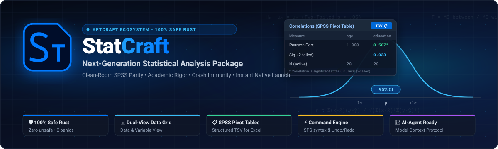
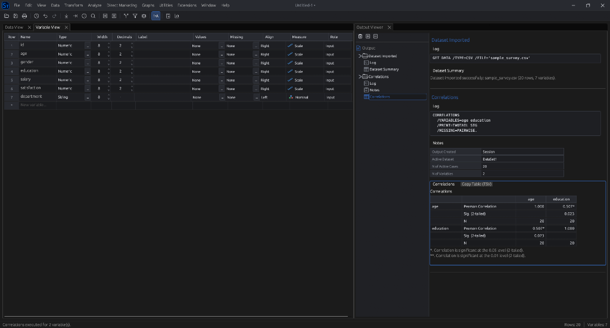

<p align="center">
  
</p>

<div align="center">
  <h3>
    <a href="https://statcraft-mu.vercel.app/">🌐 https://statcraft-mu.vercel.app/</a>
  </h3>
  <p>
    <strong>Official Website, Web Documentation & Binary Releases</strong>
  </p>

  <p>
    <a href="README.md"><strong>English</strong></a> |
    <a href="README.ru.md">Русский</a>
  </p>

  <p>
    <a href="https://statcraft-mu.vercel.app/"></a>
    <a href="https://www.rust-lang.org/"></a>
    <a href="LICENSE-MIT"></a>
    
    
    
    
    
    <a href="#4-statcraft-bridge--ai-agents-model-context-protocol--code-mode"></a>
    <a href="https://remade.wiki/projects/statcraft/"></a>
    <a href="https://app.lava.top/kobaltgit"></a>
  </p>
</div>

---

## Overview

> [!NOTE]
> 🔬 **Academic Notice:** StatCraft is an independent open-science software project. It is not affiliated with or certified by IBM SPSS Statistics. Do not use for clinical diagnostic decisions or legal compliance without independent statistical replication.

**StatCraft** is an experimental alternative for statistical data analysis built in **100% pure Safe Rust**. Developed as an open-science computational project, it combines a clean-room mathematical engine on Apache Arrow and Polars with native Model Context Protocol (MCP) integration for AI-assisted empirical research.

We do not claim StatCraft is a ready-made commercial replacement. It is an open-science computational experiment. We invite researchers, statisticians, and developers to explore the calculations, test edge cases against legacy suites (SPSS, R, Stata), and help make scientific computing transparent, verifiable, and reproducible.

<p align="center">
  
  <br>
  <em>Interactive workspace: Variable View metadata dictionary, syntax execution log, and canonical SPSS-style Output Viewer with structured pivot tables.</em>
</p>

---

## Core Pillars & Architectural Principles

Statistical software must never crash mid-calculation or produce silent numerical errors. StatCraft enforces strict memory safety, layered dependencies, and a zero-panic contract:

* **Zero-Panic Contract (100% Safe Rust):** All non-test code strictly forbids `unwrap()`, `expect()`, `panic!()`, and `unsafe`. Potential errors (singular matrices, division by zero, insufficient sample size) are propagated through typed `Result<T, StatError>` rather than application crashes.
* **Clean-Room Implementation:** Developed without proprietary IBM SPSS code or assets. Algorithms are derived from published academic papers, ISO standards, and GNU PSPP specifications, independently verified against a SciPy Golden Oracle ($\Delta < 10^{-6}$).
* **Commands, Not Handlers:** Every analytical procedure and user interaction is an atomic engine command (`EngineCommand`). All commands support non-destructive Undo/Redo, serialize to standard SPSS syntax (`.sps`), and can be scripted headlessly.
* **Arrow Columnar Memory:** Datasets live in contiguous Apache Arrow arrays. Numerical transformations and filtering execute via SIMD-accelerated Polars engines with zero garbage collection pauses.
* **Canonical SPSS-Style Output Viewer:** Hierarchical navigation outline tree paired with authentic multi-level pivot tables. Results copy to clipboard as structured TSV that pastes into Microsoft Excel cleanly without distorted columns or unwanted date conversions.
* **Vector-First UI:** Rendered with native `egui` via `ui.painter()` and vector SVG icons. Strict zero-emoji and zero-unsupported Unicode symbol policy eliminates tofu squares (`□`) across all platforms.
* **Zero-Hardcode i18n:** 100% of user-facing strings are decoupled into Project Fluent catalogs (`locales/en.ftl`, `locales/ru.ftl`) with real-time runtime language switching.
* **Resource Guard:** Thread-limited compilation (`-j 1`, `codegen-units = 1`) protects development workstations from memory exhaustion.

---

## Key Features

> [!TIP]
> 📖 **Comprehensive Feature Guide:** An exhaustive reference of all available analytical procedures, data manipulations, transformation algorithms, and keyboard shortcuts is available in **[FEATURES.md](docs/FEATURES.md)** (English) and **[FEATURES_RU.md](docs/FEATURES_RU.md)** (Русский).

### 1. Dual-View Data Management
* **Data View (Virtualized 4-Quadrant 2D Grid):**
  - **Spatial 4-Quadrant Architecture:** Fixed top-left corner, pinned column headers (scrolls horizontally), pinned row headers (scrolls vertically), and central cell grid (2D scrolling). Row numbers remain visible at all times.
  - **High-Performance Prefix Indexing (`LineIndex`):** $O(\log N)$ coordinate searches with zero heap allocation in uniform mode for hundreds of thousands of cases.
  - **Interactive Column Resizing & Auto-Fit:** Drag-to-resize column boundaries with visual guidelines; double-click on separator triggers instant Auto-fit to content width; synchronized with SPSS dictionary metadata (`VariableMetadata.columns`).
  - **Range Selection & Keyboard Ergonomics:** Fluid marquee mouse selection, Shift-click/Shift-drag expansion, arrow navigation, Tab/Enter workflows, and **Direct Typing** (instantly starts inline editing on alphanumeric keystrokes).
  - **Rectangular TSV/CSV Clipboard:** Native clipboard copy/paste (`Ctrl+C` / `Ctrl+V`) interoperable with Excel, Google Sheets, and LibreOffice with automatic row expansion.
  - **Series Auto-Fill (Fill Handle):** Bottom-right corner marker computes linear arithmetic progressions for numeric series and repetition for categorical data.
  - **Column AutoFilter & Dropdowns:** Header filter button with vector chevron/funnel opening a dropdown with live search, checkboxes, and "(Blanks)" handling.
  - **Quick Sort via CommandBus:** Instant Ascending (A–Z) and Descending (Z–A) sorting via canonical `data.sort_cases` with 100% reversible Undo/Redo and SPSS syntax logging.
  - **Cell Context Menu:** Right-click menu for filtering by cell value, clearing filters, sorting, and clipboard operations.
  - **Data Integrity Guards:** Automated detection of numbers stored as text (`is_number_stored_as_text`) with Excel-parity green corner triangle and 1-click conversion to numeric.
  - **Value Labels Toggle (`1/A`):** Toolbar button for instant toggling between raw numeric codes and human-readable descriptive text labels.
* **Variable View:** Comprehensive metadata dictionary managing:
  - **Name:** Normalized variable identifiers.
  - **Type:** 9 canonical SPSS types (Numeric, Comma, Dot, Scientific, Date, Dollar, Custom Currency, String, Restricted Numeric).
  - **Width & Decimals:** Visual width and precision control with custom vector spinners.
  - **Labels:** Descriptive variable titles displayed in dialogs and tables.
  - **Values:** Discrete and range value labels with dedicated modal editors.
  - **Missing Values:** Configurable discrete missing values and continuous missing ranges.
  - **Columns & Align:** Table layout and alignment (Left, Center, Right).
  - **Measure:** Measurement level classification (Scale, Ordinal, Nominal) with custom vector scale icons.

### 2. Parametric & Descriptive Statistical Procedures
* **Descriptive Statistics:** Mean, Std. Error Mean, Standard Deviation, Variance, Minimum, Maximum, Range, Sum, Skewness (with SE), Kurtosis (with SE), and Valid N (listwise).
* **Frequencies:** Frequency counts, percentages, valid percentages, cumulative percentages, discrete missing value breakdown, percentiles, and quartiles.
* **One-Sample T-Test:** Student's $t$-test against customizable test values, degrees of freedom, two-tailed significance, mean differences, confidence intervals ($95\%$ default or user-defined), and dual-table SPSS output.
* **Independent-Samples T-Test:** Two-group comparison with automatic Levene's Test for Equality of Variances ($F$, $p$), Student's $t$-test (Equal Variances Assumed), Welch's $t$-test (Equal Variances Not Assumed), and full Group Statistics table.
* **Paired-Samples T-Test:** Dependent group comparison providing Paired Samples Statistics, Pearson Correlation coefficients ($r$, $p$), and Paired Differences test tables.
* **One-Way ANOVA:** One-Way Analysis of Variance with Fisher's $F$-test, between-groups and within-groups sums of squares, Levene's Test of Homogeneity of Variances, and descriptive statistics.

### 3. Canonical Output Viewer
* **Outline Tree Navigation:** Interactive document tree on the left panel to jump directly to any procedure, log, or table.
* **Pivot Tables:** Multi-tier nested tables with authentic SPSS headers, alternating row striping, and right-aligned numeric formatting.
* **TSV Clipboard Export:** One-click `[ Copy Table (TSV) ]` button with instant visual feedback and right-click context menus. Exports tables with clean headers and row separators specifically structured for Excel import.
* **Execution Protocols:** Monospace log blocks documenting executed SPSS syntax (`GET DATA`, `DESCRIPTIVES`, `T-TEST`, `ONEWAY`).

### 4. StatCraft Bridge & AI Agents (Model Context Protocol / Code Mode)

StatCraft features native **Model Context Protocol (MCP)** integration and a local IPC socket (port 18493) for bidirectional communication with AI assistants (Antigravity, Claude, ChatGPT, Ollama, and local LLMs).

<details>
<summary><b>🔍 How the StatCraft Bridge Works (Click to expand)</b></summary>

#### Natural Language Statistical Analysis with Deterministic Execution

StatCraft Bridge allows researchers to connect external AI agents directly to the local analytical engine. Instead of manually writing scripts or navigating complex dialog boxes, users can query and analyze datasets via conversational prompts:
> *"Inspect the loaded survey dataset. Compare the mean salary between males and females using an independent-samples t-test, check Levene's test for equality of variances, and report whether the difference is statistically significant."*

The connected AI agent:
1. Queries dataset metadata, measurement scales, and variable labels through the MCP bridge;
2. Formulates and executes atomic commands via StatCraft's core;
3. Retrieves validated mathematical output tables;
4. Generates an empirical summary with effect sizes, test statistics, and $p$-value interpretations.

#### Key Architectural Advantages:

1. **Deterministic Computation vs. LLM Arithmetic Errors:**
   Large Language Models frequently hallucinate or approximate numbers when aggregating raw data or estimating test statistics. StatCraft serves as the **deterministic calculation oracle**: the LLM guides the workflow, while native Rust executes verified mathematics ($\Delta < 10^{-6}$ vs. SciPy).
2. **Real-Time Visual Synchronization in the GUI:**
   As procedures run, the desktop interface updates live. Structured Pivot Tables appear in the Output Viewer, syntax logs record the audit trail, and tables can be copied directly into spreadsheets.
3. **100% Local & Privacy-Preserving:**
   The bridge operates over a local IPC socket (`127.0.0.1:18493`). Research, clinical, and proprietary datasets remain strictly on your machine.
4. **Autonomous Code Mode:**
   Agents can execute batch SPSS syntax scripts (`.sps`), sort cases, filter subsets, recode variables, and run statistical procedures programmatically.

#### How to Connect

* **Desktop GUI:** Open `Extensions -> MCP Bridge / Copilot` in StatCraft. The dialog displays connection status, live logs, and one-click setup snippets for Antigravity, Claude Desktop, and Cursor.
* **Headless CLI (stdio MCP):** Launch `statcraft.exe --mcp` inside your client's MCP configuration.
</details>

---

## 🔬 Open Invitation to Researchers & Developers

We do not claim StatCraft is a complete commercial replacement. It is an open-science computational experiment. We welcome domain expertise, empirical datasets, and rigorous scrutiny to make scientific computing transparent and reproducible:

* **For Statisticians & Researchers:** Challenge our numbers. Run your empirical datasets through StatCraft and compare results against SPSS, R, or Stata. Found a discrepancy ($\Delta > 10^{-6}$)? Report it directly on **[statcraft-mu.vercel.app](https://statcraft-mu.vercel.app/)** or open an issue on GitHub.
* **For Systems Engineers:** Help build safe, high-performance computational foundations in Safe Rust (optimizing linear algebra via `faer` and `statrs` without `unsafe`, contributing new procedures, and expanding the MCP toolset).

---

## Layered Architecture (L0 – L6)

StatCraft is engineered in strict compliance with the **ArtCraft Layering Law**. Dependencies flow strictly downwards:

```text
L6: statcraft_app        Desktop GUI (egui / eframe / DialogKit / Output Viewer)
 └── L5: statcraft_syntax CommandBus, SPS syntax parser, engine transactions
      ├── L4: statcraft_reporting Pivot table models, TSV / HTML / Text export
      └── L2: statcraft_algo      Pure statistical math (Golden Oracle vs SciPy)
           └── L1: statcraft_core In-memory dataset, RawTable, VariableDictionary
                └── L0: statcraft_io  Data codecs (CSV/TSV streaming, Excel .xlsx/.xls/.ods, SPSS .sav/.zsav)

Cross-cutting utility crates:
* statcraft_bridge Local IPC socket (18493) and Model Context Protocol (MCP) server
* statcraft_i18n   Fluent localization engine with zero hardcoded strings
* xtask            Developer tools: file-guard, layers, design-guard, parity, test-corpus
```

---

## Getting Started

### Prerequisites
* [Rust toolchain](https://rustup.rs/) (version 1.80 or newer recommended).

### Building and Running
Clone the repository and launch the desktop application:

```bash
git clone https://github.com/kobaltgit/StatCraft.git
cd StatCraft

# Run StatCraft in release mode (strictly single-threaded compiler guard)
cargo run --package statcraft_app --release -j 1
```

### Running Tests and Quality Guards

StatCraft enforces a strict **Definition of Done (DoD)**. All tests and architectural linters must pass with zero warnings:

```bash
# Run all workspace unit, integration, and golden oracle tests
cargo test --workspace -j 1

# Check file size limits across all crates (anti-monolith guard)
cargo run -p xtask -j 1 -- file-guard

# Check architectural layering rules (L0 - L6 strict downwards dependencies)
cargo run -p xtask -j 1 -- layers

# Check dialog UI design system compliance (DialogKit guard)
cargo run -p xtask -j 1 -- design-guard

# Verify SPSS feature parity status
cargo run -p xtask -j 1 -- parity

# Check website benchmark matrix and documentation parity
cargo run -p xtask -j 1 -- sync-site --check
```

---

## Project Structure

| Crate / Path | Responsibility |
|---|---|
| [`crates/statcraft_app`](crates/statcraft_app) | Desktop user interface, docking windows, DialogKit, data grid, output viewer |
| [`crates/statcraft_syntax`](crates/statcraft_syntax) | Engine command bus, transactions, undo/redo, SPSS syntax serializer |
| [`crates/statcraft_algo`](crates/statcraft_algo) | Pure mathematical algorithms (t-tests, ANOVA, regression, correlations, factor PCA, nonparametrics, frequencies) |
| [`crates/statcraft_core`](crates/statcraft_core) | In-memory `DataSet`, `RawTable`, `VariableDictionary`, measurement scales, metadata |
| [`crates/statcraft_io`](crates/statcraft_io) | Data codecs: streaming CSV/TSV, Excel workbooks (.xlsx/.xls/.ods), and SPSS files (.sav/.zsav) |
| [`crates/statcraft_reporting`](crates/statcraft_reporting) | Pivot table models, hierarchical presentation, TSV, HTML, and text rendering |
| [`crates/statcraft_bridge`](crates/statcraft_bridge) | Local IPC socket server (port 18493) and Model Context Protocol (MCP) server |
| [`crates/statcraft_i18n`](crates/statcraft_i18n) | Localization engine powered by Project Fluent (`locales/*.ftl`) |
| [`website/`](website) | Official web portal, interactive docs, benchmarks, and binary release downloads ([statcraft-mu.vercel.app](https://statcraft-mu.vercel.app/)) |
| [`xtask`](xtask) | CI/CD automation: `file-guard`, `layers`, `design-guard`, `parity`, `sync-site` |
| [`docs/`](docs) | Architecture guides, design specs, roadmaps, and development chronicle |

---

## Documentation

* **[Official Website & Web Documentation (statcraft-mu.vercel.app)](https://statcraft-mu.vercel.app/)** — Interactive web documentation, Golden Oracle benchmark matrix vs IBM SPSS 24, OS auto-detection for release binaries, and discrepancy reporting.
* **[Comprehensive Feature Guide (FEATURES.md)](docs/FEATURES.md)** / **[Справочник возможностей (RU)](docs/FEATURES_RU.md)** — Exhaustive catalog of all implemented statistical procedures, data transformations, formulas, and UI tools.
* [Contributor Guide (CONTRIBUTING.md)](CONTRIBUTING.md) — Comprehensive development regulations, Resource Guard (-j 1), architecture rules, and Definition of Done.
* [SPSS Feature Parity Checklist](docs/parity-checklist.md) — Comprehensive tracking of implemented SPSS commands and menus.
* [SPSS Algorithms Mathematical Audit](docs/SPSS_ALGORITHMS_AUDIT.md) — Rigorous Clean-Room verification against IBM SPSS 24 Algorithms guide via [Craft Anything](https://github.com/storytold/craft-anything).
* [Strategic Roadmap](docs/ROADMAP.md) — Long-term technical phases and module milestones.
* [Canonical Design Guide](docs/DESIGN_GUIDE.md) — Standard layout specifications for all modal dialogs (`DialogKit`).
* [Development Chronicle (EN)](docs/CHRONICLE.en.md) / [Хроника разработки (RU)](docs/CHRONICLE.md) — Detailed historical devlog of every architectural milestone.

---

## 💖 Support & Sponsorship

**StatCraft** is an independent open-science software project built in **100% pure Safe Rust** with zero legacy C/Fortran code. Implementing clean-room statistical algorithms, verifiable matrix algebra, and authentic pivot tables requires sustained research, verification, and engineering effort.

If **StatCraft** is helpful to your empirical research, coursework, or data workflows, you can support its continued open development:

<div align="center">

[](https://app.lava.top/kobaltgit)

**👉 [https://app.lava.top/kobaltgit](https://app.lava.top/kobaltgit)**

*(Accepts Russian cards, CIS, and international payment options)*

</div>

---

## License

This project is dual-licensed under:
* **MIT License** ([LICENSE-MIT](LICENSE-MIT))
* **Apache License, Version 2.0** ([LICENSE-APACHE](LICENSE-APACHE))

You may choose either license at your option.

All brand assets and logos in `assets/` are property of the **StatCraft** project (kobaltGIT).
