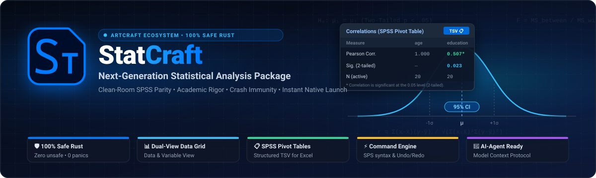
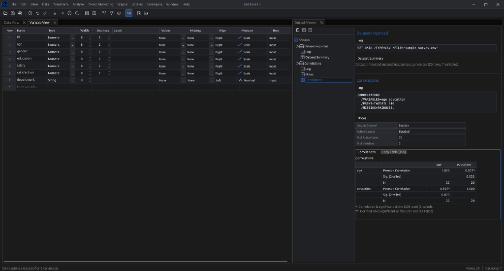

<p align="center">
  
</p>

<div align="center">
  <p>
    <a href="README.md">English</a> |
    <a href="README.ru.md"><strong>Русский</strong></a>
  </p>

  <p>
    <a href="https://www.rust-lang.org/"></a>
    <a href="LICENSE-MIT"></a>
    
    
    
    
    <a href="#4-сетевой-мост-statcraft-bridge--ии-агенты-model-context-protocol--code-mode"></a>
    <a href="https://remade.wiki/projects/statcraft/"></a>
    <a href="https://app.lava.top/kobaltgit"></a>
  </p>
</div>

---

## Обзор

**StatCraft** — это свободный современный статистический пакет с открытым исходным кодом, полностью разработанный на **100% чистом Safe Rust**. Созданный по принципу «чистой комнаты» (clean-room) как бескомпромиссная альтернатива проприетарному пакету IBM SPSS Statistics, StatCraft сочетает академическую строгость расчётов, мгновенный запуск и абсолютную устойчивость к сбоям.

Пакет предназначен для социологов, психологов, медиков, маркетологов, студентов и преподавателей университетов, предоставляя удобный графический интерфейс наряду с детерминированным аналитическим движком на базе синтаксиса команд.

<p align="center">
  
  <br>
  <em>Рабочее пространство StatCraft: Редактор переменных (Variable View), протокол синтаксиса и канонический Output Viewer со сводными таблицами (Pivot Tables) в стиле SPSS.</em>
</p>

---

## Ключевые принципы разработки

* **100% Safe Rust и гарантия «Never Crash»:** Полный отказ от `unsafe`, `panic!`, `unwrap()` и `expect()`. Любые поврежденные данные, пустые выборки или деление на ноль возвращают типизированную ошибку `Result<T, E>`, не приводя к падению программы.
* **Команды вместо обработчиков (Commands, Not Handlers):** Любое действие пользователя или математическая процедура — это типизированная команда движка (`EngineCommand`). Все команды поддерживают неразрушающую историю (Undo/Redo), сериализуются в стандартный синтаксис SPSS (`.sps`) и могут выполняться в пакетном режиме.
* **Agent-Ready & MCP-мост (Code Mode):** Встроенный сетевой сокет IPC (порт 18493) и Model Context Protocol (MCP) сервер (флаг `--mcp`). Позволяют подключать внешних ИИ-агентов (Antigravity, Claude, ChatGPT, Ollama), выполнять расчеты, исследовать переменные и передавать результаты в Output Viewer «на лету».
* **Канонический Output Viewer в стиле SPSS:** Иерархическое дерево навигации совмещено с аутентичными сводными таблицами (Pivot Tables). Результаты копируются в буфер обмена в один клик в формате структурированного TSV, который вставляется в Microsoft Excel чисто и без склеивания колонок и искажения дат.
* **Векторный интерфейс (Vector-First UI):** Чистая векторная отрисовка через `egui` (`ui.painter()`) и векторные SVG-иконки. Полный запрет на эмодзи и нестандартные Unicode-символы исключает появление уродливых квадратов «тофу» (`□`) на любых операционных системах.
* **Нулевой хардкод строк (Zero-Hardcode i18n):** 100% текстовых строк вынесены в каталоги Project Fluent (`locales/ru.ftl`, `locales/en.ftl`) с поддержкой переключения языка «на лету» без перезапуска.
* **Resource Guard:** Ограничение потоков компиляции (`-j 1`, `codegen-units = 1`) для защиты рабочей станции от зависания и перегрузки CPU/RAM.

---

## Основной функционал

> [!TIP]
> 📖 **Исчерпывающий справочник возможностей:** Полное описание всех доступных аналитических процедур, манипуляций с данными, алгоритмов трансформации и горячих клавиш доступно в документах **[FEATURES_RU.md](docs/FEATURES_RU.md)** (Русский) и **[FEATURES.md](docs/FEATURES.md)** (English).

### 1. Двухрежимное управление данными
* **Редактор данных (Data View):** Виртуализированная таблица наблюдений и переменных. Поддерживает мгновенное переключение между сырыми числовыми кодами и читаемыми текстовыми метками (`1/A`).
* **Редактор переменных (Variable View):** Полноценный словарь метаданных, управляющий всеми атрибутами:
  - **Имя (Name):** Нормализованные идентификаторы переменных.
  - **Тип (Type):** 9 канонических типов переменных SPSS (Числовой, Запятая, Точка, Научный, Дата, Доллар, Пользовательская валюта, Строка, Ограниченное число).
  - **Ширина и Дробная часть (Width & Decimals):** Визуальный контроль разрядности и точности с векторными кнопками-спиннерами.
  - **Метки (Label):** Развернутые описательные названия переменных.
  - **Значения (Values):** Модальный редактор дискретных меток значений (кодировок).
  - **Пропущенные значения (Missing):** Настройка дискретных пропусков и непрерывных диапазонов пропущенных значений.
  - **Выравнивание (Align):** Влево, По центру, Вправо.
  - **Шкала измерений (Measure):** Номинальная, Порядковая, Количественная шкала с векторными пиктограммами.

### 2. Статистические процедуры
* **Описательные статистики (Descriptives):** Среднее, Ошибка среднего, Стандартное отклонение, Дисперсия, Минимум, Максимум, Размах, Сумма, Асимметрия, Эксцесс и N валидных наблюдений (по списку).
* **Частоты (Frequencies):** Таблицы частот, проценты, валидные проценты, накопленные проценты, учет пропущенных значений, квартили и процентили.
* **Одновыборочный T-критерий (One-Sample T-Test):** t-критерий Стьюдента для заданного проверяемого значения, степени свободы, двусторонняя значимость ($p$-value), разность средних, 95% доверительные интервалы и две отдельные канонические таблицы вывода (Статистика критерия и Одновыборочный критерий).
* **Т-критерий для независимых выборок (Independent-Samples T-Test):** Сравнение двух групп с автоматическим тестом Ливиня на равенство дисперсий ($F$, $p$), критерием Стьюдента (равенство дисперсий предполагается) и критерием Уэлча (равенство дисперсий не предполагается), а также таблицей «Статистика групп».
* **Т-критерий для парных выборок (Paired-Samples T-Test):** Сравнение зависимых выборок с формированием таблиц «Статистика парных выборок», «Корреляции парных выборок» (коэффициент Пирсона $r$, $p$) и «Критерий для парных выборок».
* **Однофакторный дисперсионный анализ (One-Way ANOVA):** Критерий Фишера, межгрупповая и внутригрупповая суммы квадратов, средние квадраты, критерий однородности дисперсий Ливиня и описательные статистики с 95% ДИ.

### 3. Модуль вывода (Output Viewer)
* **Иерархическое дерево навигации (Outline):** Левая панель оглавления для мгновенного перехода к нужной процедуре, журналу или таблице.
* **Сводные таблицы (Pivot Tables):** Аутентичные многоуровневые таблицы SPSS с чередующейся подсветкой строк и выравниванием числовых колонок по правому краю.
* **Экспорт в TSV одним кликом:** Кнопка `[ Копировать таблицу (TSV) ]` с мгновенной подсветкой и контекстным меню. Таблицы разделены строками заголовков и структурированы специально для вставки в Excel.
* **Протокол синтаксиса:** Блоки журнала, фиксирующие исполненные команды синтаксиса SPSS (`GET DATA`, `DESCRIPTIVES`, `T-TEST`, `ONEWAY`) с отметками времени.

### 4. Сетевой мост StatCraft Bridge & ИИ-агенты (Model Context Protocol / Code Mode)

StatCraft — первый в мире статистический пакет, поддерживающий стандарт **Model Context Protocol (MCP)** и прямое управление через ИИ-агентов (Antigravity, Claude, ChatGPT, Ollama и любые локальные LLM).

<details>
<summary><b>🔍 Зачем нужен мост и как делать статистический анализ без знания SPSS? (Нажмите, чтобы развернуть)</b></summary>

#### Больше не нужно учить SPSS: анализ данных человеческим языком

Раньше для проведения статистического анализа требовалось либо глубокое знание сложного программного пакета (SPSS, SAS, Stata), либо знание языков программирования (R, Python). Нужно было разбираться в синтаксисе команд (`DESCRIPTIVES VARIABLES=...`), прокликивать десятки вложенных окон настроек или писать код вручную.

**Теперь всё изменилось:** благодаря сетевому мосту **StatCraft Bridge**, вам достаточно иметь рядом любимого ИИ-ассистента и подключить его к StatCraft. Вы формулируете исследовательскую задачу на простом естественном языке:
> *«Посмотри на загруженные данные опроса. Сравни среднюю заработную плату мужчин и женщин, проверь гипотезу через t-критерий Стьюдента, убедись в равенстве дисперсий по критерию Левена и объясни простыми словами, есть ли статистически значимая разница».*

ИИ-агент сам:
1. Исследует структуру файла и типы переменных через инструменты моста;
2. Сформирует и отправит команды ядру StatCraft;
3. Получит строгие академические результаты расчётов;
4. Выведет вам понятный вывод с интерпретацией уровней значимости ($p$-value).

#### В чём ключевые преимущества перед «чистым» ChatGPT или другими нейросетями?

1. **100% математическая точность против галлюцинаций LLM:**
   Языковые модели часто ошибаются («галлюцинируют») при работе с большими массивами чисел, выдавая правдоподобные, но математически неверные значения средних, стандартных отклонений и $p$-value. StatCraft выступает в роли непогрешимого **«калькулятора истины»**: нейросеть формулирует логику анализа, а вычисления выполняет нативный Rust-движок StatCraft со строгой погрешностью $\le 10^{-6}$ (верифицирован против SciPy).
2. **Живой интерактивный интерфейс на ваших глазах:**
   Пока агент рассчитывает статистику, в открытом окне StatCraft в реальном времени появляются канонические сводные таблицы (Pivot Tables), строятся журналы синтаксиса и обновляются данные. Вы видите каждую операцию и можете в любой момент продолжить работу вручную или скопировать таблицы в Excel в один клик.
3. **Полная конфиденциальность (100% Offline & Local):**
   Мост работает через локальный сетевой сокет (`127.0.0.1:18493`) исключительно на вашем компьютере. Ваши медицинские, социологические или коммерческие данные не загружаются на сторонние серверы обработки данных.
4. **Универсальный Code Mode:**
   Агент не ограничен захардкоженными сценариями. Он может выполнять любой пакетный синтаксис SPSS (`.sps`), сортировать данные, фильтровать наблюдения, перекодировать шкалы, восполнять пропуски и вычислять любые из 16 реализованных процедур.

#### Как подключить ИИ-агента к StatCraft?

* **Через GUI:** Откройте меню `Расширения -> Мост MCP / Copilot` (`Extensions -> MCP Bridge / Copilot`) в StatCraft. В окне доступен статус сервера, журнал активности, а также готовые кнопки копирования настроек конфигурации для Antigravity, Claude Desktop или Cursor.
* **Через консоль (stdio MCP):** Запустите `statcraft.exe --mcp` в конфигурации любого MCP-клиента.
</details>

---

## Архитектура слоев (L0 – L6)

StatCraft строго следует архитектурному канону **ArtCraft Layering Law**. Зависимости между крейтами направлены строго сверху вниз:

```text
L6: statcraft_app        Графический интерфейс GUI (egui / eframe / DialogKit / Output Viewer)
 └── L5: statcraft_syntax Шина команд CommandBus, парсер синтаксиса .sps, транзакции
      ├── L4: statcraft_reporting Модель сводных таблиц, экспорт TSV / HTML / Text
      └── L2: statcraft_algo      Чистая математика (Золотой Оракул против SciPy)
           └── L1: statcraft_core Датасет в памяти, RawTable, VariableDictionary
                └── L0: statcraft_io  Кодеки данных (потоковый CSV/TSV, Excel .xlsx/.xls/.ods, SPSS .sav/.zsav)

Вспомогательные сквозные модули:
* statcraft_bridge Сетевой сокет IPC (18493) и Model Context Protocol (MCP) сервер
* statcraft_i18n   Движок локализации на Fluent без хардкода строк в коде
* xtask            Инструменты сборщика: file-guard, layers, design-guard, parity, test-corpus
```

---

## Сборка и запуск

### Требования
* Установленный компилятор [Rust](https://rustup.rs/) (рекомендуется версия 1.80 или новее).

### Клонирование и запуск
Склонируйте репозиторий и запустите настольное приложение:

```bash
git clone https://github.com/kobaltgit/StatCraft.git
cd StatCraft

# Запуск StatCraft в релизном режиме с защитой от перегрузки CPU/RAM
cargo run --package statcraft_app --release -j 1
```

### Запуск тестов и линтеров качества

StatCraft соблюдает строгий регламент **Definition of Done (DoD)**. Все тесты и статические линтеры архитектуры обязаны проходить без единого предупреждения:

```bash
# Запуск всех модульных, интеграционных и оракульных тестов
cargo test --workspace -j 1

# Проверка лимитов размера файлов (защита от раздутия и монолитизации)
cargo run -p xtask -j 1 -- file-guard

# Проверка слоистой архитектуры (L0 - L6 строгая направленность зависимостей)
cargo run -p xtask -j 1 -- layers

# Проверка соблюдения дизайн-системы диалоговых окон (DialogKit)
cargo run -p xtask -j 1 -- design-guard

# Проверка паритета команд SPSS
cargo run -p xtask -j 1 -- parity
```

---

## Структура проекта

| Крейт / Путь | Назначение |
|---|---|
| [`crates/statcraft_app`](crates/statcraft_app) | Графический интерфейс пользователя, докинг, DialogKit, грид данных, Output Viewer |
| [`crates/statcraft_syntax`](crates/statcraft_syntax) | Шина команд движка, транзакции, undo/redo, сериализатор синтаксиса SPSS |
| [`crates/statcraft_algo`](crates/statcraft_algo) | Чистые математические алгоритмы (t-тесты, ANOVA, регрессия, корреляции, факторный анализ, непараметрика, частоты) |
| [`crates/statcraft_core`](crates/statcraft_core) | Структуры в памяти: `DataSet`, `RawTable`, `VariableDictionary`, шкалы измерений, метаданные |
| [`crates/statcraft_io`](crates/statcraft_io) | Кодеки данных: потоковый CSV/TSV, книги Excel (.xlsx/.xls/.ods) и файлы SPSS (.sav/.zsav) |
| [`crates/statcraft_i18n`](crates/statcraft_i18n) | Движок интернационализации на базе Project Fluent (`locales/*.ftl`) |
| [`xtask`](xtask) | Утилиты проверки: `file-guard`, `layers`, `design-guard`, `parity` |
| [`docs/`](docs) | Архитектурные руководства, гайдлайн дизайна диалогов, дорожная карта, летопись |

---

## Документация

* **[Полный справочник возможностей (FEATURES_RU.md)](docs/FEATURES_RU.md)** / **[Feature Guide (EN)](docs/FEATURES.md)** — Исчерпывающий каталог всех реализованных статистических процедур, преобразований данных, формул и интерфейсных инструментов.
* [Руководство контрибьютора (CONTRIBUTING.md)](CONTRIBUTING.md) — Исчерпывающий регламент разработки, Resource Guard (-j 1), архитектурные слои и Definition of Done.
* [Чек-лист паритета с SPSS (Parity Checklist)](docs/parity-checklist.md) — Детальное отслеживание соответствия команд и меню SPSS.
* [Дорожная карта (Roadmap)](docs/ROADMAP.md) — Долгосрочные технические фазы и этапы развития.
* [Руководство по дизайну окон (Design Guide)](docs/DESIGN_GUIDE.md) — Стандарт компоновки диалоговых окон (`DialogKit`).
* [Хроника разработки (RU)](docs/CHRONICLE.md) / [Development Chronicle (EN)](docs/CHRONICLE.en.md) — Авторская летопись каждого архитектурного этапа.

---

## 💖 Поддержка и донаты

**StatCraft** — это амбициозный, математически строгий статистический пакет, создаваемый с нуля на **100% чистом Safe Rust** без использования устаревших C/Fortran-библиотек. Разработка и аналитическая валидация математических алгоритмов (параметрические и непараметрические критерии, ANOVA, тест Ливиня, регрессия, синтаксис SPSS и сводные таблицы) требует колоссальных исследовательских усилий и времени.

Если **StatCraft** полезен для вашей научной работы, университетских занятий или практических исследований, и вы хотите поддержать дальнейшее развитие проекта:

<div align="center">

[](https://app.lava.top/kobaltgit)

**👉 [https://app.lava.top/kobaltgit](https://app.lava.top/kobaltgit)**

*(Поддерживаются карты банков РФ, СНГ и зарубежные способы оплаты)*

</div>

---

## Лицензия

Кодовая база проекта распространяется под двойной свободной лицензией:
* **MIT License** ([LICENSE-MIT](LICENSE-MIT))
* **Apache License, Version 2.0** ([LICENSE-APACHE](LICENSE-APACHE))

Вы можете выбрать любую из лицензий по вашему усмотрению.

Все графические ассеты и логотипы в `assets/` принадлежат проекту **StatCraft** (kobaltGIT).
