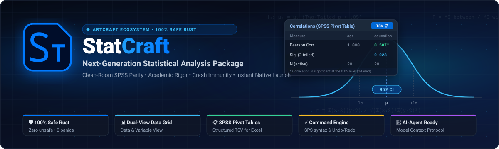
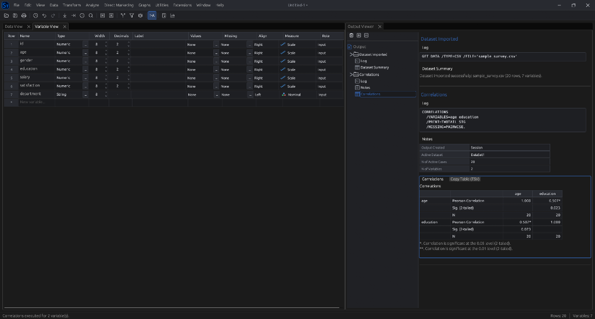

<p align="center">
  
</p>

<div align="center">
  <h3>
    <a href="https://statcraft-mu.vercel.app/">🌐 https://statcraft-mu.vercel.app/</a>
  </h3>
  <p>
    <strong>Официальный сайт, веб-документация и готовые бинарные сборки</strong>
  </p>

  <p>
    <a href="README.md">English</a> |
    <a href="README.ru.md"><strong>Русский</strong></a>
  </p>

  <p>
    <a href="https://statcraft-mu.vercel.app/"></a>
    <a href="https://www.rust-lang.org/"></a>
    <a href="LICENSE-MIT"></a>
    
    
    
    
    
    <a href="#4-сетевой-мост-statcraft-bridge--ии-агенты-model-context-protocol--code-mode"></a>
    <a href="https://remade.wiki/projects/statcraft/"></a>
    <a href="https://app.lava.top/kobaltgit"></a>
  </p>
</div>

---

## Обзор

> [!NOTE]
> 🔬 **Уведомление об исследовательской природе проекта:** StatCraft — независимый проект открытой науки. Программа не аффилирована с IBM SPSS Statistics. Не предназначена для клинических медицинских диагнозов и судебной экспертизы без независимого воспроизведения расчетов.

**StatCraft** — экспериментальная альтернатива классическим статистическим пакетам на **100% безопасном Rust**. Это независимый проект открытой науки, объединяющий чистую математическую реализацию на чистом Safe Rust со встроенным протоколом Model Context Protocol (MCP) для совместных исследований с ИИ.

Мы не заявляем, что StatCraft — это готовая замена коммерческим пакетам. Это открытый вычислительный эксперимент. Мы приглашаем исследователей, статистиков и разработчиков изучать расчёты, проверять граничные случаи в сравнении с существующими пакетами (SPSS, R, Stata) и помогать делать научные вычисления прозрачными, проверяемыми и воспроизводимыми.

<p align="center">
  
  <br>
  <em>Рабочее пространство StatCraft: Редактор переменных (Variable View), протокол синтаксиса и канонический Output Viewer со сводными таблицами (Pivot Tables) в стиле SPSS.</em>
</p>

---

## Ключевые принципы и надежность архитектуры

Статистический пакет не имеет права аварийно падать посреди расчета или замалчивать ошибки NaN. StatCraft следует строгим контрактам надежности памяти и разделения слоев:

* **Контракт нулевых паник (100% Safe Rust):** В коде строго запрещены `unwrap()`, `expect()`, `panic!()` и `unsafe`. Любые нештатные ситуации (вырожденная матрица, деление на ноль, малая выборка) возвращаются типизированными `Result<T, StatError>`.
* **Принцип чистой комнаты (Clean-Room):** Разработка ведется без заимствования проприетарного кода или ассетов IBM SPSS. Все алгоритмы воспроизводятся исключительно по открытым научным статьям, стандартам ISO и спецификациям GNU PSPP с верификацией против «Золотого оракула» SciPy ($\Delta < 10^{-6}$).
* **Команды вместо обработчиков (Commands, Not Handlers):** Любое действие пользователя или математическая процедура — это типизированная команда движка (`EngineCommand`). Все команды поддерживают неразрушающую историю (Undo/Redo), сериализуются в стандартный синтаксис SPSS (`.sps`) и могут выполняться пакетно.
* **Колоночная архитектура на Safe Rust:** Данные и словарь переменных организованы в типизированные структуры с транзакционным буфером правок (`DeltaBuffer`), обеспечивающим мгновенный Undo/Redo и детерминированную работу без пауз сборщика мусора.
* **Канонический Output Viewer в стиле SPSS:** Иерархическое дерево навигации совмещено с аутентичными многоуровневыми сводными таблицами (Pivot Tables). Результаты копируются в буфер обмена в один клик в формате структурированного TSV, который вставляется в Microsoft Excel чисто и без склеивания колонок и искажения дат.
* **Векторный интерфейс (Vector-First UI):** Чистая векторная отрисовка через `egui` (`ui.painter()`) и векторные SVG-иконки. Полный запрет на эмодзи и нестандартные Unicode-символы исключает появление уродливых квадратов «тофу» (`□`) на любых операционных системах.
* **Нулевой хардкод строк (Zero-Hardcode i18n):** 100% текстовых строк вынесены в каталоги Project Fluent (`locales/ru.ftl`, `locales/en.ftl`) с поддержкой переключения языка «на лету» без перезапуска.
* **Resource Guard:** Ограничение потоков компиляции (`-j 1`, `codegen-units = 1`) для защиты рабочей станции от зависания и перегрузки CPU/RAM.

---

## Основной функционал

> [!TIP]
> 📖 **Исчерпывающий справочник возможностей:** Полное описание всех доступных аналитических процедур, манипуляций с данными, алгоритмов трансформации и горячих клавиш доступно в документах **[FEATURES_RU.md](docs/FEATURES_RU.md)** (Русский) и **[FEATURES.md](docs/FEATURES.md)** (English).

### 1. Двухрежимное управление данными
* **Редактор данных (Data View — 4-квадрантная 2D-сетка):**
  - **Пространственная архитектура 4 квадрантов:** Закрепленные заголовки колонок сверху, закрепленные номера строк слева, центральная область данных со скроллингом в 2D. Номера строк не уплывают за край экрана при горизонтальной прокрутке.
  - **Высокопроизводительная индексация (`LineIndex`):** Префиксные суммы обеспечивают $O(\log N)$ бинарный поиск ячеек с нулевыми аллокациями памяти на куче для сотен тысяч наблюдений.
  - **Интерактивный ресайз столбцов и автоподбор (Auto-fit):** Изменение ширины перетаскиванием границы с направляющей линией; двойной клик по разделителю подбирает оптимальную ширину по содержимому; двусторонняя синхронизация со словарем метаданных SPSS (`VariableMetadata.columns`).
  - **Прямоугольное выделение и эргономика клавиатуры:** Выделение диапазона рамкой мыши, `Shift`-клик/`Shift`-drag, стрелки, Tab/Enter и **Direct Typing** (мгновенный ввод данных в активную ячейку без предварительного клика).
  - **Прямоугольный буфер обмена TSV/CSV:** Двусторонний обмен (`Ctrl+C` / `Ctrl+V`) с Excel, Google Sheets и LibreOffice с авторасширением строк датасета.
  - **Серийное автозаполнение (Fill Handle):** Векторный маркер протяжки в углу выделения рассчитывает шаг арифметической прогрессии для чисел и повторение для категорий.
  - **Колоночный автофильтр:** Интерактивная кнопка в заголовке с векторным шевроном/воронкой открывает выпадающее окно с живым поиском, чекбоксами и обработкой категории «(Пустые)».
  - **Быстрая сортировка через CommandBus:** Сортировка по возрастанию (A–Z) и убыванию (Z–A) через каноническую команду `data.sort_cases` со 100% обратимым Undo/Redo и выводом в синтаксис SPSS.
  - **Контекстное меню ячеек:** Правый клик мыши открывает меню («Фильтровать по значению», «Очистить фильтр», «Сортировка», «Копировать/Вставить»).
  - **Контроль целостности данных:** Автоматическое обнаружение чисел, сохраненных как текст, с зеленым треугольным маркером в углу ячейки и мгновенной конвертацией в число по клику.
  - **Переключение меток значений (`1/A`):** Кнопка на панели инструментов для мгновенного переключения между кодами и читаемыми текстовыми метками.
* **Редактор переменных (Variable View):** Полноценный словарь метаданных, управляющий всеми атрибутами:
  - **Имя (Name):** Нормализованные идентификаторы переменных.
  - **Тип (Type):** 9 канонических типов переменных SPSS (Числовой, Запятая, Точка, Научный, Дата, Доллар, Пользовательская валюта, Строка, Ограниченное число).
  - **Ширина и Дробная часть (Width & Decimals):** Визуальный контроль разрядности и точности с векторными кнопками-спиннерами.
  - **Метки (Label):** Развернутые описательные названия переменных.
  - **Значения (Values):** Модальный редактор дискретных меток значений (кодировок).
  - **Пропущенные значения (Missing):** Настройка дискретных пропусков и непрерывных диапазонов пропущенных значений.
  - **Выравнивание (Align):** Влево, По центру, Вправо.
  - **Шкала измерений (Measure):** Номинальная, Порядковая, Количественная шкала с векторными пиктограммами.

### 2. Статистические процедуры
* **Описательные статистики (Descriptives):** Среднее, Ошибка среднего, Стандартное отклонение, Дисперсия, Минимум, Максимум, Размах, Сумма, Асимметрия, Эксцесс и N валидных наблюдений (по списку).
* **Частоты (Frequencies):** Таблицы частот, проценты, валидные проценты, накопленные проценты, учет пропущенных значений, квартили и процентили.
* **Одновыборочный T-критерий (One-Sample T-Test):** t-критерий Стьюдента для заданного проверяемого значения, степени свободы, двусторонняя значимость ($p$-value), разность средних, 95% доверительные интервалы и две отдельные канонические таблицы вывода (Статистика критерия и Одновыборочный критерий).
* **Т-критерий для независимых выборок (Independent-Samples T-Test):** Сравнение двух групп с автоматическим тестом Ливиня на равенство дисперсий ($F$, $p$), критерием Стьюдента (равенство дисперсий предполагается) и критерием Уэлча (равенство дисперсий не предполагается), а также таблицей «Статистика групп».
* **Т-критерий для парных выборок (Paired-Samples T-Test):** Сравнение зависимых выборок с формированием таблиц «Статистика парных выборок», «Корреляции парных выборок» (коэффициент Пирсона $r$, $p$) и «Критерий для парных выборок».
* **Однофакторный дисперсионный анализ (One-Way ANOVA):** Критерий Фишера, межгрупповая и внутригрупповая суммы квадратов, средние квадраты, критерий однородности дисперсий Ливиня и описательные статистики с 95% ДИ.

### 3. Модуль вывода (Output Viewer)
* **Иерархическое дерево навигации (Outline):** Левая панель оглавления для мгновенного перехода к нужной процедуре, журналу или таблице.
* **Сводные таблицы (Pivot Tables):** Аутентичные многоуровневые таблицы SPSS с чередующейся подсветкой строк и выравниванием числовых колонок по правому краю.
* **Экспорт в TSV одним кликом:** Кнопка `[ Копировать таблицу (TSV) ]` с мгновенной подсветкой и контекстным меню. Таблицы разделены строками заголовков и структурированы специально для вставки в Excel.
* **Протокол синтаксиса:** Блоки журнала, фиксирующие исполненные команды синтаксиса SPSS (`GET DATA`, `DESCRIPTIVES`, `T-TEST`, `ONEWAY`) с отметками времени.

### 4. Сетевой мост StatCraft Bridge & ИИ-агенты (Model Context Protocol / Code Mode)

StatCraft оснащён встроенной поддержкой открытого стандарта **Model Context Protocol (MCP)** и локальным IPC-сокетом (порт 18493) для двусторонней связи с внешними ИИ-ассистентами (Antigravity, Claude, ChatGPT, Ollama и локальными LLM).

<details>
<summary><b>🔍 Как устроен мост StatCraft Bridge (Нажмите, чтобы развернуть)</b></summary>

#### Статистический анализ человеческим языком с детерминированным исполнением

Мост StatCraft Bridge позволяет исследователю подключить любимого ИИ-ассистента напрямую к локальному вычислительному ядру. Вместо ручного составления скриптов или поиска нужных параметров в многоуровневых меню, задачу можно формулировать на естественном языке:
> *«Посмотри на загруженные данные опроса. Сравни среднюю заработную плату мужчин и женщин, проверь гипотезу через t-критерий Стьюдента, убедись в равенстве дисперсий по критерию Левена и объясни простыми словами, есть ли статистически значимая разница».*

Подключенный ИИ-агент автономно:
1. Запрашивает метаданные датасета, шкалы измерений и словарь переменных через протокол MCP;
2. Формирует и передает типизированные команды ядру StatCraft;
3. Получает математически верифицированные таблицы вывода;
4. Формирует содержательный научный вывод с интерпретацией уровней значимости ($p$-value) и величины эффекта.

#### Ключевые архитектурные преимущества:

1. **Детерминированные вычисления против арифметических ошибок LLM:**
   Большие языковые модели часто ошибаются («галлюцинируют») при агрегации больших числовых массивов или вычислении нелинейных критериев. StatCraft служит **«калькулятором истины»**: нейросеть направляет ход исследования, а расчёты производит нативный Rust-движок с допуском $\Delta < 10^{-6}$ относительно SciPy.
2. **Живая синхронизация с интерфейсом на ваших глазах:**
   По мере выполнения процедур десктопный интерфейс StatCraft обновляется в реальном времени: в Output Viewer формируются канонические сводные таблицы (Pivot Tables), протоколируется синтаксис, а результаты можно скопировать в электронные таблицы в один клик.
3. **100% конфиденциальность (Offline & Local):**
   Мост работает через локальный сетевой сокет (`127.0.0.1:18493`). Ваши медицинские, исследовательские или коммерческие данные никогда не покидают пределы рабочей станции.
4. **Универсальный пакетный Code Mode:**
   Агент может исполнять синтаксис SPSS (`.sps`), сортировать наблюдения, фильтровать подвыборки, перекодировать шкалы и запускать любые реализованные процедуры.

#### Как подключить ИИ-агента

* **Через графический интерфейс:** Откройте меню `Расширения -> Мост MCP / Copilot` (`Extensions -> MCP Bridge / Copilot`) в StatCraft. В окне доступен статус сервера, журнал активности и готовые сниппеты конфигурации для Antigravity, Claude Desktop и Cursor.
* **Через консоль (stdio MCP):** Укажите команду `statcraft.exe --mcp` в настройках любого MCP-клиента.
</details>

---

## 🔬 Открытое приглашение исследователям и разработчикам

Мы не заявляем, что StatCraft — это готовая коммерческая замена. Это открытый вычислительный эксперимент. Нам нужен ваш исследовательский опыт, ваши датасеты и ваша придирчивость, чтобы сделать научные вычисления прозрачными и воспроизводимыми:

* **Для исследователей и статистиков:** Бросьте вызов нашим расчётам. Прогоните ваши рабочие массивы через StatCraft и сравните сводные таблицы с SPSS, R или Stata. Нашли расхождение ($\Delta > 10^{-6}$)? Отправьте тикет прямо с сайта **[statcraft-mu.vercel.app](https://statcraft-mu.vercel.app/)** или откройте задачу на GitHub.
* **Для Rust-инженеров и разработчиков:** Помогите строить надежную вычислительную платформу на безопасном системном программировании (оптимизация процедур линейной алгебры на чистом Safe Rust без `unsafe`, внедрение новых статистических процедур и расширение инструментария MCP).

---

## Архитектура слоев (L0 – L6)

StatCraft строго следует архитектурному канону **ArtCraft Layering Law**. Зависимости между крейтами направлены строго сверху вниз:

```text
L6: statcraft_app        Графический интерфейс GUI (egui / eframe / DialogKit / Output Viewer)
 └── L5: statcraft_syntax Шина команд CommandBus, парсер синтаксиса .sps, транзакции
      ├── L4: statcraft_reporting Модель сводных таблиц, экспорт TSV / HTML / Text
      └── L2: statcraft_algo      Чистая математика (Золотой Оракул против SciPy)
           └── L1: statcraft_core Датасет в памяти, RawTable, VariableDictionary
                └── L0: statcraft_io  Кодеки данных (потоковый CSV/TSV, Excel .xlsx/.xls/.ods, SPSS .sav/.zsav)

Вспомогательные сквозные модули:
* statcraft_bridge Сетевой сокет IPC (18493) и Model Context Protocol (MCP) сервер
* statcraft_i18n   Движок локализации на Fluent без хардкода строк в коде
* xtask            Инструменты сборщика: file-guard, layers, design-guard, parity, sync-site
```

---

## Сборка и запуск

### Требования
* Установленный компилятор [Rust](https://rustup.rs/) (рекомендуется версия 1.80 или новее).

### Клонирование и запуск
Склонируйте репозиторий и запустите настольное приложение:

```bash
git clone https://github.com/kobaltgit/StatCraft.git
cd StatCraft

# Запуск StatCraft в релизном режиме с защитой от перегрузки CPU/RAM
cargo run --package statcraft_app --release -j 1
```

### Запуск тестов и линтеров качества

StatCraft соблюдает строгий регламент **Definition of Done (DoD)**. Все тесты и статические линтеры архитектуры обязаны проходить без единого предупреждения:

```bash
# Запуск всех модульных, интеграционных и оракульных тестов
cargo test --workspace -j 1

# Проверка лимитов размера файлов (защита от раздутия и монолитизации)
cargo run -p xtask -j 1 -- file-guard

# Проверка слоистой архитектуры (L0 - L6 строгая направленность зависимостей)
cargo run -p xtask -j 1 -- layers

# Проверка соблюдения дизайн-системы диалоговых окон (DialogKit)
cargo run -p xtask -j 1 -- design-guard

# Проверка паритета команд SPSS
cargo run -p xtask -j 1 -- parity

# Проверка синхронизации сайта и матрицы аудита
cargo run -p xtask -j 1 -- sync-site --check
```

---

## Структура проекта

| Крейт / Путь | Назначение |
|---|---|
| [`crates/statcraft_app`](crates/statcraft_app) | Графический интерфейс пользователя, докинг, DialogKit, грид данных, Output Viewer |
| [`crates/statcraft_syntax`](crates/statcraft_syntax) | Шина команд движка, транзакции, undo/redo, сериализатор синтаксиса SPSS |
| [`crates/statcraft_algo`](crates/statcraft_algo) | Чистые математические алгоритмы (t-тесты, ANOVA, регрессия, корреляции, факторный анализ, непараметрика, частоты) |
| [`crates/statcraft_core`](crates/statcraft_core) | Структуры в памяти: `DataSet`, `RawTable`, `VariableDictionary`, шкалы измерений, метаданные |
| [`crates/statcraft_io`](crates/statcraft_io) | Кодеки данных: потоковый CSV/TSV, книги Excel (.xlsx/.xls/.ods) и файлы SPSS (.sav/.zsav) |
| [`crates/statcraft_reporting`](crates/statcraft_reporting) | Модель сводных таблиц (Pivot Tables), TSV, HTML и текстовый экспорт |
| [`crates/statcraft_bridge`](crates/statcraft_bridge) | Локальный сокет IPC (порт 18493) и сервер Model Context Protocol (MCP) |
| [`crates/statcraft_i18n`](crates/statcraft_i18n) | Движок интернационализации на базе Project Fluent (`locales/*.ftl`) |
| [`website/`](website) | Официальный веб-портал, интерактивная документация, бенчмарки и загрузка релизов ([statcraft-mu.vercel.app](https://statcraft-mu.vercel.app/)) |
| [`xtask`](xtask) | Утилиты проверки: `file-guard`, `layers`, `design-guard`, `parity`, `sync-site` |
| [`docs/`](docs) | Архитектурные руководства, гайдлайн дизайна диалогов, дорожная карта, летопись |

---

## Документация

* **[Официальный сайт и веб-документация (statcraft-mu.vercel.app)](https://statcraft-mu.vercel.app/)** — Интерактивная веб-документация, матрица бенчмарков «Золотого оракула» против IBM SPSS 24, автоопределение ОС для загрузки готовых бинарников и отправка отчетов о расхождениях.
* **[Полный справочник возможностей (FEATURES_RU.md)](docs/FEATURES_RU.md)** / **[Feature Guide (EN)](docs/FEATURES.md)** — Исчерпывающий каталог всех реализованных статистических процедур, преобразований данных, формул и интерфейсных инструментов.
* [Руководство контрибьютора (CONTRIBUTING.md)](CONTRIBUTING.md) — Исчерпывающий регламент разработки, Resource Guard (-j 1), архитектурные слои и Definition of Done.
* [Чек-лист паритета с SPSS (Parity Checklist)](docs/parity-checklist.md) — Детальное отслеживание соответствия команд и меню SPSS.
* [Математический аудит алгоритмов SPSS](docs/SPSS_ALGORITHMS_AUDIT_RU.md) — Постраничная Clean-Room верификация против руководства IBM SPSS 24 с помощью [Craft Anything](https://github.com/storytold/craft-anything).
* [Дорожная карта (Roadmap)](docs/ROADMAP.md) — Долгосрочные технические фазы и этапы развития.
* [Руководство по дизайну окон (Design Guide)](docs/DESIGN_GUIDE.md) — Стандарт компоновки диалоговых окон (`DialogKit`).
* [Хроника разработки (RU)](docs/CHRONICLE.md) / [Development Chronicle (EN)](docs/CHRONICLE.en.md) — Авторская летопись каждого архитектурного этапа.

---

## 💖 Поддержка и донаты

**StatCraft** — это независимый проект открытой науки, создаваемый на **100% чистом Safe Rust** без использования устаревших C/Fortran-библиотек. Разработка чистых алгоритмов, верифицируемой матричной алгебры и аутентичных сводных таблиц требует постоянных исследовательских и инженерных усилий.

Если **StatCraft** полезен для вашей научной работы, университетских занятий или практических исследований, вы можете поддержать дальнейшее развитие проекта:

<div align="center">

[](https://app.lava.top/kobaltgit)

**👉 [https://app.lava.top/kobaltgit](https://app.lava.top/kobaltgit)**

*(Поддерживаются карты банков РФ, СНГ и зарубежные способы оплаты)*

</div>

---

## Лицензия

Кодовая база проекта распространяется под двойной свободной лицензией:
* **MIT License** ([LICENSE-MIT](LICENSE-MIT))
* **Apache License, Version 2.0** ([LICENSE-APACHE](LICENSE-APACHE))

Вы можете выбрать любую из лицензий по вашему усмотрению.

Все графические ассеты и логотипы в `assets/` принадлежат проекту **StatCraft** (kobaltGIT).
