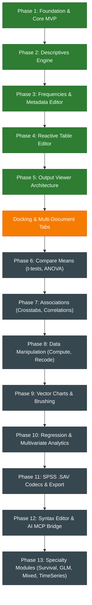

# StatCraft — Strategic Roadmap
### High-Performance Open-Source Statistical Package in 100% Pure Safe Rust
**ArtCraft (`storytold`) Ecosystem Canon | Dual-licensed under MIT OR Apache-2.0**

---

## 1. Mission and Architectural Canon

**StatCraft** is built as an uncompromising, high-performance, crash-proof, and fully open alternative to IBM SPSS Statistics.

* **100% Safe Rust & Never Crash:** Zero `unsafe`, zero `panic!`, zero `unwrap()`. Malformed input, empty arrays, or division by zero will never crash the application.
* **Commands, Not Handlers:** Every user action and analytical procedure is an engine command (`EngineCommand`) supporting Undo/Redo, serialization into classic SPSS syntax (`.sps`), and automation by AI agents.
* **Agent-First Architecture:** Built-in Model Context Protocol (MCP) and local IPC socket for native external AI orchestrator control and automated natural language interpretations in Output Viewer.
* **Zero-Hardcode i18n:** 100% UI string isolation in Fluent catalogs (`ru.ftl`, `en.ftl`) with runtime language switching without restarting.
* **Vector-First UI:** Clean vector rendering for widgets, scale indicators, and badges via `ui.painter()` and cached SVGs. Strict prohibition of emoji and rare Unicode characters that cause "tofu" boxes (`□`).
* **Resource Guard:** Compilation and testing strictly throttled (`jobs = 1`, `codegen-units = 1`) to preserve user workstation stability.

---

## 2. Development Status Matrix

---

## 3. Delivered Milestones

### [x] Phase 1: Scaffolding, Core MVP & UI Foundation
* **L0 Codecs (`statcraft_io`):** Streaming CSV/TSV parser with automatic delimiter detection (`,`, `;`, `\t`) and type inference (Numeric, Text, Date).
* **L1 Data Engine (`statcraft_core`):** Tabular `DataSet`, `VariableDictionary` with measurement scales (`Scale`, `Ordinal`, `Nominal`), `ValueLabels`, `MissingValues`, and `DeltaBuffer` for granular cell Undo/Redo.
* **L5 Command Bus (`statcraft_syntax`):** Typed `CommandBus` with readiness predicates (`enabled`) and JSON parameter specifications for AI agents.
* **L6 Desktop GUI (`statcraft_app`):** `egui_dock` layout with 3 core workspaces (Data View, Variable View, Output Viewer).
* **Localization (`statcraft_i18n`):** Fluent engine, `t!()` macro, and `i18n_lint_test` enforcing 0% raw Cyrillic strings in UI code.
* **Branding & Windows Integration:** Vector icon embedded into PE executable resource `.rsrc` and window header.

### [x] Phase 2: L2 Mathematical Engine & Descriptive Statistics
* **L2 Mathematical Algorithms (`statcraft_algo`):** `compute_descriptives` verified against Python `scipy.stats` reference values ($\le 10^{-6}$ precision).
* **L5 Command `DescriptivesCommand`:** Registered in `CommandBus`, emitting SPSS `DESCRIPTIVES VARIABLES=...` syntax.
* **L6 Variable Picker Dialog:** Centered compact modal ($500 \times 420$ px) with vector transfer chevrons and double-click support.
* **L6 SPSS Pivot Table Display:** Full dock height in **Output Viewer** in authentic SPSS styling.

### [x] Phase 3: Frequency Analysis & Variable Dictionary Modals
* **L2 `statcraft_algo`:** `compute_frequencies_detailed` procedure with value labels, missing value filtering, percentiles, and quartiles ($Q_1, Q_2, Q_3$).
* **L5 Metadata Commands:** `var.set_value_labels` and `var.set_missing_values` with Undo/Redo history.
* **L6 Metadata Editors & Dialogs:**
  * Centered frequency modal `FrequenciesDialog`;
  * Modal `ValueLabelsDialog` (`[...]` button in Values column);
  * Modal `MissingValuesDialog` (discrete codes and numeric range);
  * Toolbar button `1/A` in Data View for toggling numeric codes to human-readable labels.

### [x] Phase 4: Full Two-Way Reactive Data & Variable Grid
* **L1 SPSS Type Engine:** Support for all 9 SPSS canonical variable types (`Numeric`, `Comma`, `Dot`, `Scientific`, `Date`, `Dollar`, `CustomCurrency`, `String`, `RestrictedNumeric`).
* **L1 Blank Dataset Mode:** Immediate session readiness (`DataSet::blank(40, 0)`) without needing to load an external file.
* **L6 Variable View:** Inline borderless editing of names and labels, interactive `▲ / ▼` spinners for width and decimals, alignment and role selectors, ghost add-row `*`.
* **L6 Data View:** Inline cell editing with `Enter` / `Tab` navigation, row pre-warming when editing bottom row, row context menus.
* **L6 VariableTypeDialog:** Modal type configuration dialog with width, precision, date format, and currency prefix settings.

### [x] Phase 5: Output Viewer Architecture & i18n Layout Shield
* **Hierarchical Document Model:** `OutputProcedure`, `OutputNotes`, `OutputItem`, `OutputItemKind`, infinite continuous vertical document scroll.
* **Interactive Outline Tree:** Vector icons for document root, procedure folders, syntax log, notes, pivot tables, and warnings.
* **Synchronized Navigation:** Outline tree selection smoothly scrolls the canvas (`ui.scroll_to_rect`) with accent focus outline (`Tokens::ACCENT`).
* **TSV Export:** Clipboard copying of pivot tables and frequencies preserving spreadsheet column alignment for Excel and Google Sheets.
* **i18n Layout Shield:**
  * Dynamic column width measurement via `layout_no_wrap` with horizontal scrolling;
  * Strict cell clipping (`with_clip_rect`), preventing text spillover across columns;
  * Compact vector outline toolbar buttons ($24 \times 22$ px): `paint_icon_trash`, `paint_icon_expand_all`, `paint_icon_collapse_all` with hover tooltips.

---

## 4. Multi-Document Dock Workspace Architecture (Dockable Workspace)

Evolution of the docking architecture to provide maximum workflow flexibility while eliminating accidental data or panel loss:

### 4.1. Permanent System Workspaces (Permanent Tabs)
* **Close Protection (`closeable = false`):**
  * Core dataset tabs (**Data View** and **Variable View**) are session foundations and have no close button `[x]`. Users cannot accidentally close their dataset views.
* **Authentic SPSS Mode Switcher:**
  * Status bar tab buttons `[ Data View | Variable View ]` anchored at the bottom of the data grid, providing familiar one-click view toggling.

### 4.2. "Window" Menu & Layout Management
* **"Window" Menu:**
  * Listing of all active views and documents with checkmarks indicating visibility;
  * Quick-reveal for hidden or collapsed panels.
* **Reset Workspace Layout:**
  * `Window > Reset Workspace Layout` command immediately restores the default layout (e.g. Data View on the left, Output Viewer on the right, or clean tabs) if a user rearranges panels inconveniently.
* **Layout Presets:**
  * Analysis Preset (Data View left, Output Viewer right);
  * Classic SPSS Preset (maximized single-tab documents);
  * Scripting Preset (Syntax Editor top, Data View bottom).

### 4.3. Dynamic Document Tabs (User Document Tabs)
Opened via `File > New / Open...`, equipped with standard close buttons `[x]` and dirty-state confirmation prompts:
1. **Multi-Dataset Management (`DataSet1`, `DataSet2`, ...):**
   * Concurrent multi-file workflow in a single session;
   * Split View for side-by-side comparison of datasets;
   * Required foundation for file merger operations (*Merge Files: Add Cases / Add Variables*).
2. **Syntax Editor (`.sps`):**
   * Dedicated syntax script editor tab with line numbering, keyword syntax highlighting, and batch execution `Run`;
   * Destination for the `Paste` button from analysis dialogs.
3. **Multiple Output Documents (`.spv`):**
   * Support for parallel output logs (e.g., exploratory scratchpad vs. clean publication report).
4. **Interactive Chart Editor:**
   * Visualization tabs featuring *Brushing & Linking* (selecting points or bars automatically highlights corresponding cases in Data View).
5. **AI Copilot Console (StatCraft Copilot / `statcraft_bridge`):**
   * Conversational terminal for executing analyses, data transformations, and natural language interpretation via Model Context Protocol (MCP).

### 4.4. "File" Menu Architecture, StatCraft Projects (.stc), and SPSS (.sav / .zsav) Codecs

Upgrading the File menu from a primitive CSV loader into an all-inclusive research lifecycle management hub:

#### A. Unified Workspace Project Container (`.stc` — StatCraft Project)
In classic SPSS, datasets (`.sav`), output logs (`.spv`), and scripts (`.sps`) are fragmented across disconnected files, often severing the link between reports and specific data versions.
* **The `.stc` Project Format:** A native, open format built on Apache Parquet and structured JSON metadata, packaging into a single hermetic container:
  1. The complete tabular dataset (`DataSet`);
  2. The full variable dictionary with rich metadata (`VariableDictionary`: types, measurement scales, `ValueLabels`, user and system missing values `MissingValues`, alignment, column widths, decimal precision);
  3. The entire `Output Viewer` workbook (all generated procedures, pivot tables, frequency distributions, `Notes` blocks, and syntax execution history);
  4. Application UI layout state and docking topology (`DockState`), restoring the user's workspace exactly as it was when reopened.

#### B. Native Support for IBM SPSS Statistics Formats (`.sav` and `.zsav`)
Direct opening of SPSS data files without converters or proprietary closed-source libraries (Clean-Room canon on L0 `statcraft_io`):
* Binary `.sav` reading conforming to the open GNU PSPP specification;
* Streaming decompression of compressed `.zsav` archives using zlib;
* Automatic conversion of SPSS variable records into the internal `VariableDictionary` (measurement levels, `SYSMIS` codes, multibyte character encodings);
* Export back to `.sav` for seamless round-trip compatibility with SPSS users.

#### C. Hierarchical Structure of the "File" Menu
* **New ▶:**
  * New Project (`.stc`) — `Ctrl+Shift+N`;
  * New Dataset (Blank Sheet) — `Ctrl+N`;
  * Syntax File (`.sps`).
* **Open Project (`.stc`)...** — `Ctrl+Shift+O`.
* **Open Data (`.sav`, `.zsav`, `.csv`, `.tsv`, `.stc`)...** — `Ctrl+O`.
* **Import Data ▶:**
  * SPSS Data File (`*.sav`, `*.zsav`)...
  * Delimited Text File (CSV, TSV, TXT)...
  * Excel Spreadsheet (`*.xlsx`)... (future roadmap).
* **Recent Projects & Files ▶:** Fast launch for the last 10 session files with on-disk path history.
* **Save Project (`.stc`)** — `Ctrl+S`.
* **Save Project As...** — `Ctrl+Shift+S`.
* **Save Data As (`.sav`, `.csv`, `.tsv`)...**
* **Export ▶:**
  * Export Output Workbook (HTML, PDF, TSV)...
  * Export Dataset to CSV / Excel...
* **Close Project** — `Ctrl+W`.
* **Exit** — `Alt+F4`.

### 4.5. "Edit" Menu Architecture

The central operational hub for data manipulation, bidirectional command history, and dataset navigation:
* **Bidirectional History Stack:**
  * Full Undo/Redo (`Ctrl+Z`, `Ctrl+Y` / `Ctrl+Shift+Z`) backed by `CommandBus` for all data grid, variable dictionary, and analysis steps.
* **Specialized Clipboard Operations:**
  * Cut (`Ctrl+X`), Copy (`Ctrl+C`), Paste (`Ctrl+V`), Clear (`Delete`);
  * **Copy with Variable Names (`Ctrl+Shift+C`):** exports selected cells with an auto-generated header row, ready for pasting into external spreadsheets and publication reports.
* **High-Capacity Dataset Navigation:**
  * **Go to Case (`Ctrl+G`):** instant virtualized scrolling jump to a case by line number (essential for datasets with hundreds of thousands or millions of cases);
  * **Go to Variable (`Ctrl+J`):** fuzzy search and column focus by variable name or descriptive label across large questionnaires.
* **Grid Search and Replacement:**
  * Find (`Ctrl+F`): substring or exact case-sensitive matching across columns;
  * Replace (`Ctrl+H`): batch category code and typo replacement.
* **Insert Case & Insert Variable:** Insert a new row or column immediately before the active cursor position.
* **Options / Preferences Dialog:** Modular environment configuration dialog:
  * *Tab 1: General:* UI language (EN/RU), visual theme, recent files limit, session auto-save interval;
  * *Tab 2: Data Grid:* decimal separator selection (dot `12.5` vs. comma `12,5`), new variable defaults (width 8, decimals 2), show value labels by default;
  * *Tab 3: Fonts & Scale:* table grid font size (9–14 pt), UI scaling factor (100%, 125%, 150% for HiDPI/4K);
  * *Tab 4: Output:* pivot table visual style (Classic SPSS, Academic APA), $p$-value styling (`* p < .05`, `** p < .01`);
  * *Tab 5: AI & MCP Bridge:* MCP server socket port (18492), dataset access permissions, interpretation verbosity.

### 4.6. "View" Menu Architecture

Managing data presentation, visual readability, language switching, and color themes:
* **UI Language ▶:** Runtime language switching without restart (`Russian`, `English`, effortlessly extensible by dropping new `.ftl` files into `locales/`).
* **Value Labels — `1/A`:** Instant toggling between raw numeric codes and human-readable descriptive category labels (`1` $\leftrightarrow$ `Male`).
* **Visual Themes ▶:**
  * **Light Theme (Classic SPSS):** traditional light grey/white background with contrast grid lines and blue header accents familiar to SPSS users;
  * **Dark Theme (Dark Pro):** modern dark aesthetic engineered to minimize eye strain during long-session analysis;
  * **Auto (System):** automatic synchronization with the host Windows OS dark/light mode preference.
* **Zoom & Font Size:**
  * Rapid table font scaling (`Ctrl++`, `Ctrl+-`, `Ctrl+0`);
  * Tailored readability on high-DPI (4K/Retina) displays.
* **Grid Lines:** Toggle cell border rendering visibility on the data canvas.
* **Status Bar:**
  * Displays case count $N$, variable count $P$, and memory footprint;
  * Live status flags: active selection filter (`Filter On`), sample weighting (`Weight On`), and file split (`Split File On`).
* **Toolbars:** Show/hide the top vector action toolbar.

### 4.7. "Data" Menu Architecture

Matrix-level data manipulation, dataset topology, and sample conditioning:
* **Sort Cases...:** Multi-level ascending/descending observation sorting across one or multiple variables;
* **Sort Variables...:** Reorder columns in data and variable dictionary views by name, type, label, or measurement level;
* **Transpose...:** Matrix rotation swapping rows into columns and columns into rows;
* **Merge Files ▶:**
  * **Add Cases...:** vertical dataset concatenation (combining waves of observations);
  * **Add Variables...:** horizontal relational table joining by primary key ID (JOIN / VLOOKUP);
* **Restructure...:** Format transformation between Wide (repeated measurements in distinct columns) and Long (time factor and score column) required for repeated-measures ANOVA and mixed models;
* **Aggregate...:** Collapsing observation rows with group-level summaries (means, sums, medians);
* **Split File...:** Global mode executing all analytical procedures separately per subgroup with live `[Split File On]` status bar flag;
* **Select Cases...:** Filtering cases by logical criteria (`Age >= 18 AND Income > 0`) with strikethrough visual masking and `[Filter On]` status bar flag;
* **Weight Cases...:** Applying sampling weights to balance representative population margins with `[Weight On]` status bar flag.

### 4.8. "Transform" Menu Architecture — 100% Parity with IBM SPSS Statistics

The comprehensive mathematical feature engineering, data imputation, and matrix conditioning toolchain:
* **Compute Variable...:** Column formula calculator supporting arithmetic (`SQRT`, `ABS`, `LN`, `EXP`), row-wise statistics (`MEAN`, `SUM`, `SD`, `MIN`, `MAX`), string functions (`CONCAT`, `SUBSTR`), and conditional logical assignments (`IF (condition) Target = expression`);
* **Shift Values (Lead & Lag)...:** Time-series lag/lead operators (`LAG(x, 1)`) for autoregressive econometric modeling and rate-of-change calculation;
* **Recode ▶:**
  * **Recode into Different Variables...:** Non-destructive continuous-to-categorical binning (e.g. age cohorts, income brackets) into a newly minted variable;
  * **Recode into Same Variables...:** In-place modification of existing column cells;
  * **Automatic Recode...:** Instant alphanumeric text conversion into contiguous integer codes (`1`, `2`) accompanied by automatic generation of dictionary `ValueLabels`;
* **Create Dummy Variables...:** Instant transformation of multi-category discrete scales into binary 0/1 indicator columns for multiple regression models;
* **Visual Binning...:** Interactive modal featuring a live histogram preview with draggable cut points for slicing variables into equal percentiles, cut points, or standard deviation intervals;
* **Optimal Binning...:** Supervised discretization optimizing predictor bin relationships against a categorical target variable;
* **Prepare Data for Modeling (ADP)...:** Automated data preparation, anomaly screening, and statistical normalization;
* **Rank Cases...:** Order rank calculation with tie handling (Mean, Low, High ties);
* **Date and Time Wizard...:** Multi-step wizard for date arithmetic: duration calculation (exact age, tenure), date addition/subtraction, component extraction (day of week, quarter, year);
* **Create Time Series...:** Moving averages, exponential smoothing series, and difference transforms to eliminate secular trend;
* **Replace Missing Values (Data Imputation)...:** Algorithmic gap filling via Series Mean, Mean of Nearby Points, Median of Nearby Points, Linear Interpolation, or Linear Trend at point;
* **Random Number Generators & Seed...:** Pseudorandom seed initialization guaranteeing 100% reproducibility in split-sample validation and Monte Carlo experiments;
* **Count Values within Cases...:** Row-wise targeted value occurrence counter (survey battery scales, symptom clusters);
* **Programmability Transformations...:** Custom execution of transformation pipelines via the local `statcraft_bridge` socket.

### 4.9. "Analyze" Menu Architecture — 100% Parity with IBM SPSS Statistics

The complete inventory of applied statistical procedures organized by canonical thematic submenus:
* **Descriptive Statistics ▶:**
  * **Frequencies...:** frequency distributions, percentages, valid percentages, cumulative percentages, custom percentiles, quartiles ($Q_1, Q_2, Q_3$);
  * **Descriptives...:** mean, standard error, variance, standard deviation, minimum, maximum, range, skewness $G_1$, kurtosis $G_2$;
  * **Explore...:** exploratory data analysis (EDA), Boxplots, stem-and-leaf plots, Kolmogorov-Smirnov (with Lilliefors significance correction) and Shapiro-Wilk normality tests;
  * **Crosstabs...:** two-way contingency tables, Pearson Chi-Square ($\chi^2$), Fisher's Exact Test, Yates' continuity correction, association coefficients (Cramér's $V$, $\phi$, contingency coefficient);
* **Compare Means ▶:**
  * **One-Sample T Test...:** test sample mean against an external hypothesized parameter $\mu_0$;
  * **Independent-Samples T Test...:** two-group mean difference testing, Levene's test for equality of variances (reporting Student's $t$ and Welch's $t$);
  * **Paired-Samples T Test...:** dependent matched-pairs / repeated-measures "before-and-after" testing;
  * **One-Way ANOVA...:** between-group and within-group variance analysis for $3+$ groups with post-hoc multiple comparisons (Tukey HSD, Bonferroni correction);
* **General Linear Model (GLM) ▶:**
  * **Univariate (ANCOVA)...:** analysis of covariance conditioning on continuous metric covariates;
  * **Multivariate (MANOVA)...:** multivariate analysis of variance evaluating multiple continuous dependent variables simultaneously;
  * **Repeated Measures ANOVA...:** longitudinal experimental designs with Mauchly's test of sphericity;
* **Correlate ▶:**
  * **Bivariate...:** Pearson product-moment ($r$), Spearman rank-order ($\rho$), and Kendall tau ($\tau$) correlation matrices with two-tailed significance testing;
  * **Partial...:** linear association between two variables controlling for the linear effect of one or more additional covariates;
* **Regression ▶:**
  * **Linear...:** multiple Ordinary Least Squares (OLS) regression, unstandardized $B$ and standardized $\beta$ coefficients, $R^2$, ANOVA $F$-test, collinearity diagnostics (VIF, Tolerance);
  * **Binary Logistic...:** dichotomous event probability modeling (0/1), Odds Ratios $\text{Exp}(B)$, Wald test, Hosmer-Lemeshow goodness-of-fit;
  * **Multinomial & Ordinal Logistic...:** multi-category unordered and ordered logit modeling;
  * **Curve Estimation...:** quadratic, cubic, logarithmic, inverse, and power curve fitting;
* **Nonparametric Tests ▶:**
  * **Independent Samples:** Mann-Whitney $U$ test (2 groups), Kruskal-Wallis $H$ test ($K$ groups);
  * **Related Samples:** Wilcoxon signed-rank test (2 paired conditions), Friedman test ($K$ conditions);
* **Dimension Reduction & Classify ▶:**
  * **Factor Analysis / PCA...:** sampling adequacy (KMO, Bartlett's sphericity test), Scree plot eigenvalue extraction, Varimax orthogonal rotation;
  * **Cluster Analysis...:** $K$-Means clustering and agglomerative hierarchical clustering with proximity distance matrices and dendrogram visualization;
* **Scale > Reliability Analysis...:** Internal consistency evaluation via Cronbach's Alpha ($\alpha$) and item-deleted scale sensitivity statistics;
* **Survival ▶:** Actuarial Life Tables, Kaplan-Meier product-limit survivor curves with Log-Rank tests, Cox Proportional Hazards Regression.

### 4.10. "Direct Marketing" Menu Architecture — Commercial Extension

Applied decision-support and customer segmentation toolchain for CRM and commercial marketing analytics (*slated for late-stage implementation following completion of core statistical procedures*):
* **RFM Analysis (Recency, Frequency, Monetary)...:** Customer transactional scoring partitioning client databases into actionable tiers (Champions, Loyal, Promising, At Risk, Dormant);
* **Profile Potential Contacts...:** Comparative demographic and behavioral profiling identifying characteristics of positive campaign respondents;
* **Cluster Analysis for Segmentation...:** Simplified customer clustering wizard tailored for domain marketing practitioners;
* **Control Package Test (A/B Testing)...:** Statistical testing verifying significant response rate improvements across campaign variants;
* **Postal Code Response Rate...:** Geographic segmentation evaluating localized conversion efficiency across regions.

### 4.11. "Graphs" Menu Architecture — L3 statcraft_charts Vector Engine

Interactive scientific visualization engine built on `egui_plot` featuring bidirectional data canvas coupling (Brushing & Linking) and publication-grade vector export:
* **Chart Builder...:** Interactive visual canvas featuring a drag-and-drop gallery of graph elements onto coordinate axes ($X$, $Y$) and cluster grouping slots;
* **Histogram...:** Continuous distribution plotting with configurable binning intervals and theoretical Gaussian normal curve overlay;
* **Bar Chart...:** Simple, clustered, and stacked bar diagrams with 95% confidence interval error bars;
* **Boxplot («Box-and-Whisker»)...:** Visualization of medians, interquartile ranges ($IQR$), $1.5 \times IQR$ fences, and labeled outlier observation markers;
* **Scatter / Dot Plot...:** Bivariate point clouds with linear regression trendlines and $N \times N$ scatterplot matrices for correlation screening;
* **Error Bar...:** Mean comparisons displaying confidence intervals and standard errors;
* **Pie Chart...:** Category share proportions with percentage badges;
* **Line Chart...:** Longitudinal trajectory and time series trend tracking;
* **Population Pyramid...:** Bilateral demographic distribution plots;
* **Brushing & Linking Interactivity:** Selecting points or bars on the plot dynamically highlights corresponding records in Data View;
* **Vector Graphics Export:** True vector SVG export (ideal for peer-reviewed academic journals without resolution degradation) and high-DPI raster PNG (300+ DPI).

### 4.12. "Utilities" Menu Architecture — Metadata & Questionnaire Structure

Dictionary inspection, large-scale questionnaire partitioning, and dataset documentation:
* **Variables / Quick Inspector...:** Floating rapid-inspection modal displaying complete metadata for any variable (data type, survey question label, `ValueLabels` table, missing value rules) with a direct cursor focus jump in the active grid without switching tabs;
* **Variable Sets (Define & Use)...:** Logical grouping of hundreds of questionnaire items into named domain subsets ("Demographics", "Depression Scales", "Financial History") to filter variable picker lists across all analysis dialogs;
* **Data File Comments...:** Embedded research annotation log tracking audit history, cleaning steps, and sample origins stored directly within `.stc` and `.sav` headers;
* **Codebook Generator...:** Automatic compilation of a comprehensive study codebook tabulating all dictionary scales, category encodings, and value distributions for documentation and archival handoff.

### 4.13. "Extensions" Menu Architecture — Extensibility, AI MCP & Scripting

The open scientific ecosystem bridge integrating external community packages, custom interfaces, and agentic AI models:
* **Extension Hub...:** Centralized repository browsing, discovering, and installing community-authored procedure packages with one-click installation;
* **Install Local Extension (.scpl)...:** Offline package installer for StatCraft Plugin archives (`.scpl`) adhering to the *Zero-Core Hardcoding* canon;
* **Custom Dialog Builder...:** Graphical form designer enabling analysts without low-level Rust experience to construct bespoke dialog modals rendered natively on `egui` and mapped to syntax/Python pipelines;
* **AI & Model Context Protocol (MCP) Hub...:** Operational console monitoring the internal MCP server, exposing tools for autonomous orchestration by external AI agents (Antigravity, Claude, local LLMs);
* **Scripting Runtime Bridge (Python & R Bridge via `statcraft_bridge`)...:** IPC socket management (18492) and runtime environment path binding for executing custom statistical scripts with safe Arrow memory sharing.

### 4.14. "Window" Menu Architecture — Docking Management & Layout Presets

Orchestration of the `egui_dock` multi-document interface, layout safeguards, and split-screen workflows:
* **Reset Workspace Layout...:** Panic recovery command restoring default factory topology (Data View on the left, Output Viewer on the right) when panels are accidentally closed or misaligned;
* **Layout Presets ▶:**
  * *Analysis Preset (Split View):* simultaneous view of the data matrix on the left and live calculation reports on the right;
  * *Classic SPSS Preset:* maximized document tabs spanning the entire window frame;
  * *Scripting Preset:* horizontal split with Syntax Editor `.sps` on top and Data View below;
* **Active Document & View Listing (with direct shortcuts and visibility checks):**
  * `[✓] Data View` — `Ctrl+1`;
  * `[✓] Variable View` — `Ctrl+2`;
  * `[✓] Output Viewer` — `Ctrl+3`;
  * `[ ] Syntax Editor` — `Ctrl+4`;
  * `[ ] AI Copilot Console` — `Ctrl+5`;
* **Minimize All / Restore All Panels.**

### 4.15. "Help" Menu Architecture — Educational Center & Open Science

Statistical pedagogy, transparent algorithmic specifications, and onboard sample libraries:
* **Statistics Coach & AI Guide...:** Interactive decision tree guiding researchers to appropriate statistical tests based on scale types, sample dimensions, and normality assumptions, offering direct modal launch;
* **Mathematical & Algorithm Reference...:** Transparent documentation of the statistical formulas implemented in the L2 `statcraft_algo` core, cross-referenced with peer-reviewed literature and SciPy benchmarks;
* **Syntax Reference...:** Language specification and syntax grammar guide for `.sps` script automation;
* **Built-in Sample Datasets ▶:** Single-click onboarding datasets:
  * Fisher's Iris Dataset (*iris.csv*);
  * Blood Pressure Clinical Trial (*bp_trial.csv*);
  * Customer Satisfaction Survey (*survey.csv*);
* **Check for Updates...:** Notification and release verification service;
* **About StatCraft...:** Application version, dual MIT / Apache-2.0 licensing, repository links, memory safety audit status (100% Safe Rust), and authorship credits.

---

## 5. Analytical Roadmap Ahead

### [x] Phase 6: Compare Means & Hypothesis Testing
* **One-Sample T-Test:**
  * Compares sample mean against hypothesized test value $\mu_0$;
  * $t$-statistic, degrees of freedom $df$, two-tailed $p$-value, 95% confidence interval of the difference.
* **Independent-Samples T-Test:**
  * Levene's Test for Equality of Variances ($F$-statistic and $p$-value);
  * Student's $t$-test (equal variances assumed) and Welch's $t$-test (equal variances not assumed);
  * Grouping variable and group definition dialog.
* **Paired-Samples T-Test:**
  * Repeated measures / paired observations, pair correlation, difference $t$-statistic.
* **One-Way ANOVA:**
  * Between-group and within-group Sum of Squares ($SS$), Mean Squares ($MS$), Fisher's $F$-test;
  * Post-Hoc Tests: Tukey HSD, Bonferroni correction.

### [ ] Phase 7: Association Analysis & Non-Parametric Tests
* **Crosstabulations (Crosstabs):**
  * Two-way contingency tables for nominal/ordinal scales;
  * Observed and expected counts, row/column/total percentages;
  * Pearson Chi-Square ($\chi^2$), Yates' continuity correction, Fisher's Exact Test ($2 \times 2$);
  * Directional and symmetric measures: Pearson contingency coefficient, Cramér's $V$, $\phi$.
* **Bivariate Correlations:**
  * Pearson linear correlation ($r$);
  * Spearman ($\rho$) and Kendall ($\tau$) rank correlations;
  * Correlation matrix with significance stars ($* p < 0.05$, $** p < 0.01$).
* **Non-Parametric Tests:**
  * Mann-Whitney $U$ test (independent two-group alternative);
  * Wilcoxon signed-rank test (paired samples alternative);
  * Kruskal-Wallis $H$ test (one-way ANOVA alternative).

### [ ] Phase 8: Data Manipulation & Transformation
* **Compute Variable:**
  * Built-in safe expression parser (`TARGET = VAR_A + SQRT(VAR_B)`);
  * Mathematical, statistical, and conditional functions (`SUM`, `MEAN`, `ABS`, `LN`, `EXP`, `IF`);
  * Calculator dialog with function palette and variable selector.
* **Recode:**
  * «Recode into Same Variables» and «Recode into Different Variables»;
  * Range mapping interface (`1 thru 18 -> 1`, `19 thru 65 -> 2`, `ELSE -> Copy`).
* **Data Management:**
  * Sort Cases by multiple keys (ascending/descending);
  * Select Cases (filtering observations by logical condition);
  * Merge Files (add cases or add variables by key).

### [ ] Phase 9: Statistical Graphics & Visualization
* **Vector Plotting Engine (`egui_plot`):**
  * **Histogram:** configurable bin widths, superimposed normal curve;
  * **Bar Chart:** simple, clustered, stacked bars with 95% error bars;
  * **Boxplot:** median, IQR box, 1.5 IQR whiskers, outlier markers;
  * **Scatter Plot:** 2D point cloud with linear regression fit line;
  * **Pie Chart:** categorical share breakdown.
* **Brushing & Linking:**
  * Selecting data points in a chart automatically highlights corresponding rows in Data View.
* **High-Resolution Vector Export:** SVG and PNG export.

### [ ] Phase 10: Regression & Multivariate Analytics
* **Linear Regression:**
  * Ordinary Least Squares (OLS);
  * Coefficients ($B$, $SE_B$, standardized $\beta$, $t$-statistic, $p$-value);
  * Model summary: $R$, $R^2$, adjusted $R^2$, ANOVA $F$;
  * Multicollinearity diagnostics (VIF, Tolerance).
* **Binary Logistic Regression:**
  * Maximum likelihood estimation;
  * Odds Ratios ($\text{Exp}(B)$), Wald test, pseudo-$R^2$ (Cox & Snell, Nagelkerke).
* **Principal Component Analysis (PCA / Factor Analysis):**
  * KMO sample adequacy and Bartlett's test of sphericity;
  * Eigenvalue extraction ($\lambda > 1$) and scree plot;
  * Varimax orthogonal rotation.
* **Reliability Analysis:**
  * Cronbach's Alpha ($\alpha$) for scale internal consistency;
  * Item-total statistics (alpha if item deleted).
* **Cluster Analysis:**
  * $K$-Means clustering;
  * Hierarchical clustering with dendrogram.

### [ ] Phase 11: File Codecs & Reporting
* **IBM SPSS `.sav` and `.zsav` Codec:**
  * Native clean-room read/write support without proprietary DLLs;
  * Full preservation of metadata: variable labels, value labels, measure scales, missing values (`SYSMIS`);
  * Support for compressed `.zsav`.
* **StatCraft Native Project Codec `.stc`:**
  * High-performance columnar storage based on Apache Parquet and JSON metadata.
* **Document Export:**
  * Export Output Viewer books into PDF, Word DOCX, LaTeX, HTML, and Excel (`.xlsx`).

### [ ] Phase 12: Syntax Engine & AI Ecosystem
* **Interactive Syntax Editor:**
  * Dedicated script workspace for SPSS syntax (`.sps`);
  * Syntax highlighting, line numbers, autocomplete;
  * `Paste` button in all dialogs emits syntax directly into editor.
* **Built-in Model Context Protocol (MCP) Server:**
  * Connect external AI agents (Antigravity, Claude, local LLMs) directly to running StatCraft;
  * MCP tools: inspect dictionary, execute analyses, stream natural language interpretations directly into Output Viewer.
* **StatCraft CLI:**
  * Headless runner for automated batch pipelines: `statcraft-cli --run script.sps --output report.html`.

### [ ] Phase 13: Advanced & Specialty Modules
* **Survival Analysis (Biostatistics & Medical Science):**
  * Life Tables analysis;
  * Kaplan-Meier estimation with Log-Rank, Breslow, and Tarone-Ware tests;
  * Cox Proportional Hazards Regression with time-dependent covariates.
* **Time Series & Forecasting:**
  * Autoregressive Integrated Moving Average (*ARIMA / SARIMA*);
  * Exponential Smoothing (Single, Holt linear, Winters seasonal);
  * Autocorrelation and Partial Autocorrelation Functions (ACF / PACF);
  * Unit root / Stationarity tests (Augmented Dickey-Fuller ADF).
* **Generalized Linear Models (GLM / GENLIN):**
  * Poisson Regression for count and rare event data;
  * Negative Binomial Regression for overdispersed count data;
  * Gamma Regression and Inverse Gaussian models.
* **Linear Mixed Models (LMM):**
  * Hierarchical Linear Models (HLM) for multi-level data;
  * Repeated Measures ANOVA with random intercepts and slopes;
  * Flexible residual covariance structures (Auto-regressive AR(1), Compound Symmetry, Unstructured).
* **Complex Samples Analysis:**
  * Multi-stage stratified and clustered sample survey analysis;
  * Sampling weight adjustments with Taylor series variance estimation.
* **Specialized Marketing & Social Research Procedures:**
  * Multidimensional Scaling (*PROXSCAL / ALSCAL*);
  * Simple and Multiple Correspondence Analysis;
  * Conjoint Analysis;
  * Decision & Classification Trees (*CHAID, Exhaustive CHAID, CRT, QUEST*).

---

## 5. Quality Assurance & Definition of Done

Every roadmap feature is committed strictly when satisfying:
1. **Resource Guard:** `-j 1` on all cargo commands.
2. **100% Test Pass:** 0 failures, Golden Oracle precision $\le 10^{-6}$.
3. **i18n Linter:** 0 hardcoded strings in UI.
4. **Layer Integrity:** `cargo xtask layers` passes.
5. **Clean Linters:** `cargo clippy --workspace -j 1 -- -D warnings` and `cargo fmt --check`.
6. **Bilingual Chronicle:** Synchronous entries in `docs/CHRONICLE.md` and `docs/CHRONICLE.en.md`.
