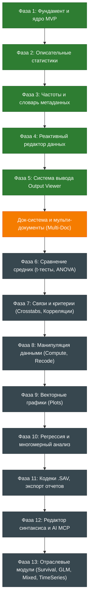

# StatCraft — Стратегическая дорожная карта (Roadmap)
### Высокопроизводительный открытый статистический пакет на 100% чистом Rust
**Стандарт экосистемы ArtCraft (`storytold`) | Двойная лицензия MIT OR Apache-2.0**

---

## 1. Миссия и архитектурный канон

**StatCraft** создаётся как бескомпромиссная, быстрая, безопасная и открытая альтернатива проприетарному пакету IBM SPSS Statistics.

* **100% Safe Rust & Never Crash:** Полный отказ от `unsafe`, `panic!`, `unwrap()`. Никакие битые данные, пустые выборки или деление на ноль не могут привести к аварийному завершению программы.
* **Commands, Not Handlers:** Любое действие пользователя или аналитическая процедура — это типизированная команда движка (`EngineCommand`), поддерживающая Undo/Redo, сериализацию в классический синтаксис SPSS (`.sps`) и управление через AI-агентов.
* **Agent-First Архитектура:** Встроенный Model Context Protocol (MCP) и локальный IPC-сокет для прямого управления расчетами и интерпретации результатов современными нейросетями.
* **Zero-Hardcode i18n:** 100% изоляция текстов интерфейса в каталогах Fluent (`ru.ftl`, `en.ftl`) с переключением языков «на лету» без перезапуска.
* **Vector-First UI:** Чистая векторная отрисовка интерфейса, шкал и индикаторов через `ui.painter()` и кэшированные SVG. Полный запрет на эмодзи и нестандартные Unicode-глифы, приводящие к квадратам «тофу» (`□`).
* **Resource Guard:** Строгий контроль задействованных ресурсов сборки (`jobs = 1`, `codegen-units = 1`), исключающий подвисание системы разработчика.

---

## 2. Матрица статуса разработки

---

## 3. Выполненные этапы (Delivered)

### [x] Фаза 1: Scaffolding, Core MVP & UI Foundation
* **L0 Codecs (`statcraft_io`):** Потоковый анализатор и парсер CSV/TSV с автоопределением разделителей (`,`, `;`, `\t`) и выводом типов (Numeric, Text, Date).
* **L1 Data Engine (`statcraft_core`):** Табличная структура `DataSet`, словарь `VariableDictionary` со шкалами (`Scale`, `Ordinal`, `Nominal`), метками `ValueLabels`, кодами пропусков `MissingValues` и буфером `DeltaBuffer` для Undo/Redo ячеек.
* **L5 Command Bus (`statcraft_syntax`):** Типизированная командная шина `CommandBus` с валидацией готовности (`enabled`) и JSON-спецификацией параметров для внешних ИИ.
* **L6 Desktop GUI (`statcraft_app`):** Док-система `egui_dock` с тремя главными рабочими пространствами (Data View, Variable View, Output Viewer).
* **Локализация (`statcraft_i18n`):** Модуль Fluent, макрос `t!()`, линтер `i18n_lint_test` с запретом сырой кириллицы в UI.
* **Айдентика и Windows-интеграция:** Векторная иконка внедрена в PE-ресурс `.exe` и в заголовок окна.

### [x] Фаза 2: Вычислительное ядро L2 statcraft_algo и Описательные статистики
* **L2 Математическое ядро (`statcraft_algo`):** Процедура `compute_descriptives` со сверкой с Python `scipy.stats` с точностью $\le 10^{-6}$.
* **L5 Команда `DescriptivesCommand`:** Интеграция в шину, экспорт в синтаксис `DESCRIPTIVES VARIABLES=...`.
* **L6 Диалог выбора переменных:** Компактное окно $500 \times 420$ px с векторными кнопками переноса и поддержкой двойного щелчка.
* **L6 Сводная таблица (Pivot Table):** Полноразмерный вывод в Output Viewer в аутентичном стиле SPSS.

### [x] Фаза 3: Частотный анализ и редакторы словаря метаданных
* **L2 `statcraft_algo`:** Процедура `compute_frequencies_detailed` с поддержкой меток значений, кодов пропусков, процентилей и квартилей ($Q_1, Q_2, Q_3$).
* **L5 Команды метаданных:** `var.set_value_labels` и `var.set_missing_values` с историей отмены Undo/Redo.
* **L6 Диалоги редактирования метаданных:**
  * Центрированный диалог частотного анализа `FrequenciesDialog`;
  * Модальный диалог меток значений `ValueLabelsDialog` (кнопка `[...]` в колонке «Значения»);
  * Модальный диалог пропущенных значений `MissingValuesDialog` (дискретные пропуски и диапазоны);
  * Кнопка `1/A` на панели инструментов Data View для мгновенного переключения числовых кодов на читаемые метки значений.

### [x] Фаза 4: Полноценный двусторонний реактивный редактор данных
* **L1 Ядро типов SPSS:** Поддержка всех 9 типов (`Numeric`, `Comma`, `Dot`, `Scientific`, `Date`, `Dollar`, `CustomCurrency`, `String`, `RestrictedNumeric`).
* **L1 Режим «Чистый лист»:** Автоматическая готовность к работе (`DataSet::blank(40, 0)`) без необходимости открывать файл.
* **L6 Variable View:** Инлайн-редактирование имени и метки без рамки, интерактивные спиннеры `▲ / ▼` для ширины и точности, селекторы выравнивания и роли, строка добавления новой переменной `*`.
* **L6 Data View:** Инлайн-ввод ячеек с навигацией клавишами `Enter` / `Tab`, авторазогрев строк при заполнении последней строки, контекстные меню строк.
* **L6 VariableTypeDialog:** Модальное окно смены типа данных с настройкой ширины, десятичных знаков, форматов дат и валют.

### [x] Фаза 5: Система вывода Output Viewer и защита от переполнения (i18n Shield)
* **Иерархическая модель документа:** `OutputProcedure`, `OutputNotes`, `OutputItem`, `OutputItemKind`, хронологический непрерывный вертикальный свиток.
* **Интерактивное дерево оглавления (Outline Pane):** Векторные пиктограммы корневого узла, папок, синтаксиса, примечаний, таблиц и предупреждений.
* **Синхронизированная навигация:** Клик в дереве центрирует холст на выбранной таблице (`ui.scroll_to_rect`) с акцентной подсветкой рамки (`Tokens::ACCENT`).
* **Экспорт в TSV:** Копирование сводных таблиц и частот в буфер обмена для мгновенной вставки в Excel / Google Sheets с сохранением колонок.
* **Устранение переполнения макетов (i18n Layout Shield):**
  * Динамический расчет ширин колонок сводных таблиц по тексту (`layout_no_wrap`) с горизонтальным скроллингом;
  * Строгое отсечение ячеек (`with_clip_rect`), исключающее наложение текста на соседние столбцы;
  * Компактные векторные кнопки тулбара оглавления ($24 \times 22$ px): `paint_icon_trash`, `paint_icon_expand_all`, `paint_icon_collapse_all` со всплывающими подсказками.

---

## 4. Архитектура док-системы и динамических вкладок (Dockable Multi-Doc Workspace)

Развитие док-системы приложения для обеспечения гибкой организации рабочего пространства и исключения случайной потери данных:

### 4.1. Постоянные системные пространства (Permanent Tabs)
* **Защита от закрытия (`closeable = false`):**
  * Вкладки текущего активного датасета (**«Представление данных» / Data View** и **«Представление переменных» / Variable View**) являются базисом сессии и лишены кнопки закрытия `[x]`. Пользователь физически не может случайно удалить их с экрана.
* **Аутентичный переключатель режимов SPSS:**
  * В нижней строке таблицы данных размещается переключатель режимов `[ Представление данных | Представление переменных ]`, обеспечивающий привычный для пользователей SPSS мгновенный переход между значениями и метаданными.

### 4.2. Меню «Окно» (Window) и управление компоновкой
* **Меню «Окно» (Window):**
  * Список всех открытых представлений и документов с галочками видимости;
  * Возможность повторного вызова скрытых панелей.
* **Сброс расположения панелей (Reset Workspace Layout):**
  * Команда меню `Окно > Сбросить расположение по умолчанию`, мгновенно возвращающая стандартную компоновку (Data View слева, Output Viewer справа или вкладки по умолчанию), если пользователь случайно нарушил структуру окон.
* **Предустановленные раскладки (Presets):**
  * «Аналитическая раскладка» (данные слева, вывод справа);
  * «Классическая раскладка SPSS» (окна в виде вкладок на весь экран);
  * «Режим скриптов» (редактор синтаксиса сверху, таблица данных снизу).

### 4.3. Динамические пользовательские вкладки (Dynamic Document Tabs)
Пользовательские документы открываются через `Файл > Создать / Открыть...`, снабжаются кнопкой закрытия `[x]` с подтверждением сохранения:
1. **Мульти-датасеты (`DataSet1`, `DataSet2`, ...):**
   * Одновременная работа с несколькими наборами данных в рамках одной сессии;
   * Параллельный просмотр и визуальное сравнение выборок на разделенном экране (Split View);
   * Поддержка процедур слияния файлов (*Merge Files: Add Cases / Add Variables*), требующих двух открытых файлов.
2. **Редактор синтаксиса (Syntax Editor / `.sps`):**
   * Вкладка полноценного текстового редактора скриптов с номерами строк и подсветкой синтаксиса;
   * Кнопка пакетного запуска `Run`;
   * Прием сгенерированного синтаксиса по кнопке `Вставить (Paste)` из диалоговых окон.
3. **Несколько документов вывода (Output Documents / `.spv`):**
   * Возможность вести независимые документы вывода (например, черновой протокол расчетов и финальный отчет для экспорта).
4. **Редактор интерактивных графиков (Chart Editor):**
   * Вкладки визуализаций с поддержкой технологии *Brushing & Linking* (выделение точек на графике синхронно подсвечивает строки в таблице данных).
5. **Консоль AI-ассистента (StatCraft Copilot / `statcraft_bridge`):**
   * Вкладка интерактивного взаимодействия с встроенным AI-агентом через MCP для управления вычислениями на естественном языке.

### 4.4. Архитектура меню «Файл», проектов StatCraft (.stc) и кодеков SPSS (.sav / .zsav)

Превращение меню «Файл» из начального загрузчика CSV в полноценный центр управления жизненным циклом аналитического исследования:

#### А. Единый файл проекта рабочей сессии (`.stc` — StatCraft Project)
В классическом пакете SPSS данные (`.sav`), протоколы расчетов (`.spv`) и скрипты (`.sps`) изолированы в независимых файлах, из-за чего результаты легко теряют связь с версией исходного массива.
* **Формат проекта `.stc`:** Нативный открытый формат на базе Apache Parquet и структурированных метаданных JSON, объединяющий в единый герметичный контейнер:
  1. Полный табличный массив данных (`DataSet`);
  2. Развернутый словарь переменных со всеми метаданными (`VariableDictionary`: типы данных, шкалы измерения, текстовые метки значений `ValueLabels`, пользовательские и системные коды пропусков `MissingValues`, выравнивание, точность);
  3. Полную книгу результатов `Output Viewer` (все сгенерированные процедуры, сводные таблицы, частотные распределения, примечания `Notes` и журнал синтаксиса);
  4. Состояние интерфейса и компоновку док-панелей (`DockState`), восстанавливая рабочее пространство в исходном виде при повторном открытии.

#### Б. Нативная поддержка форматов IBM SPSS Statistics (`.sav` и `.zsav`)
Прямое открытие архивов данных без конвертеров и сторонних проприетарных библиотек (канон Clean-Room на базе L0 `statcraft_io`):
* Чтение бинарного формата `.sav` по открытой спецификации GNU PSPP;
* Чтение сжатых файлов `.zsav` со стриминговой распаковкой zlib;
* Автоматическая конвертация словаря переменных SPSS во внутренний словарь `VariableDictionary` (метки шкал, коды пропусков `SYSMIS`, многобайтовые строки);
* Сохранение датасетов обратно в формат `.sav` для обратной совместимости с коллегами, использующими SPSS.

#### В. Иерархическая структура меню «Файл»
* **Создать (New) ▶:**
  * Новый проект (`.stc`) — `Ctrl+Shift+N`;
  * Новый датасет (Чистый лист) — `Ctrl+N`;
  * Файл синтаксиса (`.sps`).
* **Открыть проект (`.stc`)...** — `Ctrl+Shift+O`.
* **Открыть данные (`.sav`, `.zsav`, `.csv`, `.tsv`, `.stc`)...** — `Ctrl+O`.
* **Импорт данных ▶:**
  * Файл данных SPSS (`*.sav`, `*.zsav`)...
  * Текстовый файл с разделителями (CSV, TSV, TXT)...
  * Электронная таблица Excel (`*.xlsx`)... (задел на будущее).
* **Недавние проекты и файлы ▶:** Быстрый запуск последних 10 файлов сессий с запоминанием путей на диске.
* **Сохранить проект (`.stc`)** — `Ctrl+S`.
* **Сохранить проект как...** — `Ctrl+Shift+S`.
* **Сохранить данные как (`.sav`, `.csv`, `.tsv`)...**
* **Экспорт ▶:**
  * Экспорт отчета вывода (HTML, PDF, TSV)...
  * Экспорт данных в CSV / Excel...
* **Закрыть проект** — `Ctrl+W`.
* **Выход** — `Alt+F4`.

### 4.5. Архитектура меню «Правка» (Edit)

Центр операций редактирования данных, двусторонней истории правок и аналитической навигации:
* **Двунаправленная история правок:**
  * Полноценный стек Undo/Redo (`Ctrl+Z`, `Ctrl+Y` / `Ctrl+Shift+Z`) на базе шины `CommandBus` для любых действий в таблице, словаре и аналитических операциях.
* **Специализированные операции буфера обмена:**
  * Вырезать (`Ctrl+X`), Копировать (`Ctrl+C`), Вставить (`Ctrl+V`), Очистить (`Delete`);
  * **Копировать с именами переменных (`Ctrl+Shift+C`):** экспорт фрагмента матрицы с первой строкой заголовков для мгновенной вставки в отчеты и Excel с сохранением структуры колонок.
* **Быстрая навигация по большим массивам данных:**
  * **Перейти к наблюдению (`Ctrl+G`):** мгновенный прыжок виртуализированного скролла к строке по введенному номеру (незаменимо на выборках в сотни тысяч и миллионы строк);
  * **Перейти к переменной (`Ctrl+J`):** поиск и фокусировка на колонке по имени или текстовой метке при наличии сотен переменных в анкете.
* **Поиск и замена в таблице:**
  * Найти (`Ctrl+F`): поиск текстовых или числовых значений с учетом регистра и границ колонок;
  * Заменить (`Ctrl+H`): пакетная замена кодов категорий и опечаток.
* **Вставка наблюдений и переменных:** Вставка строки или столбца перед текущей позицией курсора.
* **Параметры и настройки (Options / Preferences)...:** Модульный диалог конфигурации рабочей среды:
  * *Вкладка 1: Общие (General):* выбор языка интерфейса (RU/EN), темы оформления, лимит недавних файлов, интервал автосохранения сессии;
  * *Вкладка 2: Данные и таблица (Data Grid):* выбор десятичного разделителя (точка `12.5` или запятая `12,5`), параметры колонок по умолчанию (ширина 8, 2 знака), отображение меток значений при открытии;
  * *Вкладка 3: Шрифты и масштаб (Fonts & Scale):* кегль шрифта таблицы (9–14 pt), коэффициент масштабирования UI (100%, 125%, 150% для HiDPI/4K);
  * *Вкладка 4: Вывод и таблицы (Output):* визуальный стиль сводных таблиц (Классический SPSS, Академический APA), формат маркировки $p$-value (`* p < .05`, `** p < .01`);
  * *Вкладка 5: ИИ и Мост (AI & MCP Bridge):* порт сокета MCP (18492), права доступа к датасетам, уровень детальности автоматических интерпретаций.

### 4.6. Архитектура меню «Вид» (View)

Управление отображением данных, эргономикой чтения, языком и визуальными темами:
* **Язык интерфейса (Language) ▶:** Быстрое переключение языка приложения «на лету» без перезапуска (`Русский`, `English`, расширяемо добавлением `.ftl` файлов в папку `locales/`).
* **Метки значений (Value Labels) — `1/A`:** Мгновенное переключение между «сырыми» числовыми кодами и словесными метками категорий (`1` $\leftrightarrow$ `Мужской`).
* **Темы оформления (Themes) ▶:**
  * **Светлая тема (Classic SPSS):** традиционный бело-серый интерфейс с контрастной сеткой и синими заголовками, привычный пользователям SPSS;
  * **Тёмная тема (Dark Pro):** современная тёмная палитра для снижения зрительной нагрузки при ночной и длительной работе;
  * **Авто (Системная):** автоматическая синхронизация с цветовой схемой операционной системы Windows.
* **Масштаб и шрифты (Zoom & Font Size):**
  * Быстрое увеличение/уменьшение шрифта таблицы (`Ctrl++`, `Ctrl+-`, `Ctrl+0`);
  * Оптимизация под мониторы высокой четкости (4K/Retina).
* **Сетка таблицы (Grid Lines):** Переключение видимости разделительных линий ячеек.
* **Строка состояния (Status Bar):**
  * Отображение числа наблюдений $N$, числа переменных $P$, размера файла;
  * Индикаторы фильтрации выборки (`Filter On`), взвешивания (`Weight On`), расщепления файлов (`Split File On`).
* **Панели инструментов (Toolbars):** Отображение/скрытие панели быстрых инструментов.

### 4.7. Архитектура меню «Данные» (Data)

Операции с глобальной матрицей наблюдений, структурой датасета и режимами выборки:
* **Сортировка наблюдений (Sort Cases)...:** Многоуровневая сортировка строк таблицы (возрастание / убывание) по одному или нескольким полям;
* **Сортировка переменных (Sort Variables)...:** Упорядочивание колонок в словаре и таблице по имени, типу, метке или шкале измерения;
* **Транспонирование (Transpose)...:** Преобразование строк матрицы в столбцы, а столбцов — в строки;
* **Слияние файлов (Merge Files) ▶:**
  * **Добавить наблюдения (Add Cases)...:** вертикальное объединение выборок (конкатенация двух датасетов);
  * **Добавить переменные (Add Variables)...:** горизонтальное объединение таблиц по уникальному ключевому полю ID (JOIN / VLOOKUP);
* **Реструктуризация данных (Restructure)...:** Преобразование между «широким» форматом (Wide: повторные измерения в разных столбцах) и «длинным» форматом (Long: фактор времени и столбец показателя) для ANOVA и смешанных моделей;
* **Агрегирование данных (Aggregate)...:** Схлопывание строк с расчетом средних, сумм или медиан по группирующей переменной;
* **Разделение файла (Split File)...:** Глобальный режим автоматического раздельного расчета всех статистических процедур по группам с индикатором `[Split File On]` в строке состояния;
* **Выбор наблюдений (Select Cases)...:** Фильтрация массива по логическим критериям с маркировкой исключенных строк и индикатором `[Filter On]` в строке состояния;
* **Взвешивание наблюдений (Weight Cases)...:** Учет социологических и маркетинговых весов выборки с индикатором `[Weight On]` в строке состояния.

### 4.8. Архитектура меню «Преобразовать» (Transform) — 100% паритет с IBM SPSS Statistics

Полный арсенал вычисления новых признаков, импутации данных и математической подготовки матрицы:
* **Вычислить переменную (Compute Variable)...:** Формульный калькулятор колонок, поддержка арифметических (`SQRT`, `ABS`, `LN`, `EXP`), горизонтальных статистических (`MEAN`, `SUM`, `SD`, `MIN`, `MAX`), текстовых (`CONCAT`, `SUBSTR`) и логических условных выражений (`IF (условие) Target = выражение`);
* **Сдвиг значений (Shift Values / Lead & Lag)...:** Смещение временного ряда на $N$ шагов вперед/назад (`LAG(x, 1)`) для авторегрессионного моделирования и расчета темпов прироста;
* **Перекодирование значений (Recode) ▶:**
  * **Перекодировать в другие переменные (Recode into Different Variables)...:** Безопасное разбиение непрерывных величин на категории (возрастные когорты, интервалы доходов) с созданием новой переменной;
  * **Перекодировать в те же переменные (Recode into Same Variables)...:** Модификация значений непосредственно в исходном столбце;
  * **Автоматическое перекодирование (Automatic Recode)...:** Мгновенный перевод текстовых строк («Москва», «СПб») в целочисленные коды (`1`, `2`) с автоматической генерацией меток значений `ValueLabels` в словаре;
* **Создание фиктивных/дамми-переменных (Create Dummy Variables)...:** Автоматическая генерация бинарных признаков (0/1 индикаторов) из категориальной шкалы для включения в регрессионный анализ;
* **Визуальная группировка (Visual Binning)...:** Интерактивное диалоговое окно с живой гистограммой и ползунками для нарезки непрерывного признака на равные квантили, процентили или интервалы стандартного отклонения;
* **Оптимальная группировка (Optimal Binning)...:** Дискретизация предикторов с оптимизацией связей под целевую зависимую переменную;
* **Подготовка данных для моделирования (Prepare Data for Modeling / ADP)...:** Автоматический скрининг качества данных, обнаружение аномальных выбросов и нормализация;
* **Ранжирование наблюдений (Rank Cases)...:** Расчет порядковых рангов (с обработкой совпадающих значений `Ties: Mean, Low, High`);
* **Мастер даты и времени (Date and Time Wizard)...:** Пошаговый визард календарных вычислений: разность дат (точный возраст/стаж), прибавление интервалов, извлечение дня недели/квартала/года;
* **Создание временного ряда (Create Time Series)...:** Вычисление скользящих средних, простых и сезонных разностей для очистки от тренда;
* **Замена пропущенных значений / Импутация (Replace Missing Values)...:** Автоматическое заполнение пропусков методами: среднее ряда (*Series Mean*), среднее соседних точек (*Mean of Nearby Points*), медиана, линейная интерполяция (*Linear Interpolation*), линейный тренд (*Linear Trend at point*);
* **Генераторы случайных чисел и фиксация зерна (Random Number Generators & Seed)...:** Установка начального зерна генератора псевдослучайных чисел для строго воспроизводимого сплита выборок и Монте-Карло тестов;
* **Подсчет значений в строках (Count Values within Cases)...:** Подсчет количества целевых ответов по блоку вопросов (шкалы симптомов, батареи тестов);
* **Программируемые преобразования (Programmability Transformations)...:** Запуск внешних скриптов трансформации через локальный сокет `statcraft_bridge`.

### 4.9. Архитектура меню «Анализ» (Analyze) — 100% паритет с IBM SPSS Statistics

Полный каталог прикладных статистических методов, сгруппированных по специализированным подменю:
* **Описательные статистики (Descriptive Statistics) ▶:**
  * **Частоты (Frequencies)...:** расчет частот, процентов, кумулятивных долей, перцентилей и квартилей ($Q_1, Q_2, Q_3$);
  * **Описательные (Descriptives)...:** среднее, ошибка среднего, дисперсия, $SD$, минимум, максимум, размах, асимметрия $G_1$, эксцесс $G_2$;
  * **Исследовать (Explore)...:** разведочный анализ данных, график «ящик с усами» (Boxplot), критерии нормальности Колмогорова-Смирнова (с поправкой Лиллиефорса) и Шапиро-Уилка;
  * **Таблицы сопряженности (Crosstabs)...:** двумерные таблицы частот, критерий независимости Хи-квадрат Пирсона ($\chi^2$), точный критерий Фишера, поправка Йейтса, меры связи ($V$ Крамера, $\phi$, коэффициент сопряженности);
* **Сравнение средних (Compare Means) ▶:**
  * **Одновыборочный T-критерий (One-Sample T Test)...:** проверка гипотезы о равенстве среднего контрольному эталону $\mu_0$;
  * **T-критерий для независимых выборок (Independent-Samples T Test)...:** проверка гипотезы для двух несвязанных групп, тест Ливиня на гомогенность дисперсий (критерий Стьюдента и критерий Уэлча);
  * **Парный T-критерий (Paired-Samples T Test)...:** анализ зависимых/связанных выборок (замеры «до/после»);
  * **Однофакторный дисперсионный анализ (One-Way ANOVA)...:** межгрупповое и внутригрупповое сравнение $3+$ групп с апостериорными критериями (Post-Hoc: Тьюки Tukey HSD, поправка Бонферрони);
* **Общая линейная модель (General Linear Model / GLM) ▶:**
  * **Одномерная (Univariate / ANCOVA)...:** дисперсионный анализ с включением метрических ковариат;
  * **Многомерная (Multivariate / MANOVA)...:** многомерный дисперсионный анализ для нескольких зависимых переменных;
  * **Повторные измерения (Repeated Measures ANOVA)...:** модели динамики изменений во времени с проверкой сферичности Мокли (Mauchly's Sphericity);
* **Корреляции (Correlate) ▶:**
  * **Парные (Bivariate)...:** коэффициент линейной корреляции Пирсона ($r$), ранговые корреляции Спирмена ($\rho$) и Кендалла ($\tau$) с двусторонним тестированием значимости;
  * **Частные (Partial)...:** оценка силы чистой связи между двумя признаками при статистическом контроле третьей переменной;
* **Регрессионный анализ (Regression) ▶:**
  * **Линейная регрессия (Linear)...:** метод наименьших квадратов (МНК), оценка коэффициентов $B$ и $\beta$, коэффициент детерминации $R^2$, $F$-критерий ANOVA, диагностика мультиколлинеарности (VIF, Tolerance);
  * **Бинарная логистическая (Binary Logistic)...:** моделирование вероятностей бинарных событий (0/1), отношение шансов $\text{Exp}(B)$, тест Вальда, критерии согласия Хосмера-Лемешова;
  * **Мультиномиальная и Порядковая (Multinomial / Ordinal Logistic)...:** многоклассовая и ранговая логистическая регрессия;
  * **Оценка кривых (Curve Estimation)...:** подбор степенных, логарифмических, экспоненциальных и квадратичных кривых;
* **Непараметрические критерии (Nonparametric Tests) ▶:**
  * **Для независимых выборок:** $U$-критерий Манна-Уитни (для 2 групп), $H$-критерий Крускала-Уоллиса (для $K$ групп);
  * **Для связанных выборок:** $T$-критерий Вилкоксона (для 2 замеров), критерий Фридмана (для $K$ замеров);
* **Снижение размерности и классификация (Dimension Reduction & Classify) ▶:**
  * **Факторный анализ / Метод главных компонент (Factor / PCA)...:** проверка адекватности выборки (KMO, тест Бартлетта), критерий каменистой осыпи (*Scree plot*), ортогональное вращение Варимакс;
  * **Кластерный анализ (Cluster)...:** сегментация методом $K$-средних (*K-Means*) и иерархическая кластеризация с выводом матрицы расстояний и дендрограммы;
* **Анализ надежности (Scale > Reliability Analysis)...:** Вычисление коэффициента согласованности Альфа Кронбаха ($\alpha$) и дескриптивных статистик пунктов шкалы при удалении;
* **Анализ выживаемости (Survival) ▶:** Таблицы дожития (*Life Tables*), кривые Каплана-Мейера (*Kaplan-Meier*) с лог-ранговым тестом, регрессия пропорциональных рисков Кокса (*Cox Regression*).

### 4.10. Архитектура меню «Прямой маркетинг» (Direct Marketing) — Коммерческий модуль

Специализированный прикладной инструментарий для CRM, коммерческого скоринга и оценки маркетинговых кампаний (*запланирован к реализации в заключительной очереди после завершения фундаментального статистического ядра*):
* **RFM-анализ (RFM Analysis: Recency, Frequency, Monetary)...:** Скоринг клиентской базы по давности, частоте и чеку покупок с автоматической нарезкой на сегменты (VIP, перспективные, спящие, отток);
* **Профилирование потенциальных контактов (Profile Potential Contacts)...:** Автоматический сравнительный анализ характеристик откликнувшейся аудитории против общей базы;
* **Сегментация контактов (Cluster Analysis for Segmentation)...:** Упрощенный пошаговый мастер кластеризации клиентской базы для прикладных маркетологов;
* **Тестирование контрольных пакетов (Control Package Test / A/B Test)...:** Статистическая оценка достоверности прироста отклика тестовой кампании против контрольной группы;
* **Анализ отклика по регионам и индексам (Postal Code Response Rate)...:** Оценка географической конверсии маркетинговых предложений.

### 4.11. Архитектура меню «Графика» (Graphs) — Векторный движок L3 statcraft_charts

Интерактивная научная визуализация на базе `egui_plot` с поддержкой двусторонней связи с таблицей (Brushing & Linking) и векторного экспорта:
* **Построитель диаграмм (Chart Builder)...:** Визуальный конструктор графиков с галереей макетов, холстом предпросмотра и перетаскиванием переменных на оси координат ($X$, $Y$) и группы кластеризации;
* **Гистограмма (Histogram)...:** Частотное распределение непрерывных признаков с настраиваемым шагом карманов (*bins*) и наложением теоретической нормальной кривой Гаусса;
* **Столбчатая диаграмма (Bar Chart)...:** Простые, кластеризованные (сгруппированные) и накопительные столбики с планками погрешностей (доверительные интервалы 95% CI);
* **Диаграмма размаха (Boxplot / «Ящик с усами»)...:** Визуализация медианы, межквартильного размаха ($IQR$), усов ($1.5 \times IQR$) и индивидуальных точек-выбросов (*outliers*) с подписями номеров наблюдений;
* **Диаграмма рассеяния (Scatter / Dot Plot)...:** Двумерное облако точек с наложением линии регрессионного тренда и матрица диаграмм рассеяния ($N \times N$) для комплексной оценки корреляций;
* **Планки погрешностей (Error Bar)...:** Сравнение средних значений с отображением доверительных интервалов и стандартных ошибок;
* **Круговая диаграмма (Pie Chart)...:** Структура долей категориальных признаков с процентными метками;
* **Линейные графики (Line Chart)...:** Отображение трендов и динамики во времени;
* **Половозрастная пирамида (Population Pyramid)...:** Двусторонняя демографическая диаграмма распределения выборки;
* **Интерактивность Brushing & Linking:** Выделение точек или полос на графике синхронно подсвечивает соответствующие строки в таблице Data View;
* **Векторный экспорт:** Экспорт диаграмм в высоком полиграфическом качестве в векторный SVG (для публикаций в научных журналах) и растровый PNG (300+ DPI).

### 4.12. Архитектура меню «Служебные» (Utilities) — Метаданные и организация анкет

Инструменты инспекции словаря переменных, структурирования масштабных опросников и документирования датасетов:
* **Карточка переменной (Variables / Quick Inspector)...:** Компактное окно быстрого просмотра полных метаданных выбранной колонки (тип, формулировка вопроса, таблица кодов `ValueLabels`, правила пропусков) с кнопкой мгновенного перехода в таблице без переключения вкладок;
* **Наборы переменных (Variable Sets: Define & Use)...:** Группировка сотен анкетных колонок в тематические именованные подмножества («Демография», «Шкалы симптомов», «Экономический блок») для фильтрации списков переменных во всех диалоговых окнах анализа;
* **Комментарии к датасету (Data File Comments)...:** Вшитый в контейнер проекта текстовый мета-журнал правок и описания происхождения выборки, сохраняемый в заголовках `.stc` и `.sav`;
* **Генератор кодовой книги (Codebook Generator)...:** Автоматическая компиляция исчерпывающего академического паспорта исследования со сводкой всех шкал, кодировок и распределений ответов для отчетов и архивов.

### 4.13. Архитектура меню «Расширения» (Extensions) — Экосистема плагинов, AI MCP и скрипты

Мост расширяемости программы, интеграции со сторонними библиотеками и экосистемой искусственного интеллекта:
* **Каталог расширений (Extension Hub)...:** Централизованный репозиторий автономных плагинов и пакетов статистических процедур с установкой в один клик;
* **Установка локальных пакетов (.scpl)...:** Автономная установка пакетов расширений StatCraft Plugin (`.scpl`) без пересборки программы по канону *Zero-Core Hardcoding*;
* **Конструктор диалогов (Custom Dialog Builder)...:** Визуальный редактор, позволяющий исследователю без навыков низкоуровневого программирования конструировать собственные диалоговые окна с автоматической трансляцией в интерфейс на `egui` и привязкой к скриптам;
* **Центр управления AI / Model Context Protocol (MCP Hub)...:** Инструментарий мониторинга и настройки встроенного MCP-сервера для прямого управления StatCraft со стороны AI-агентов (Antigravity, Claude, локальные LLM);
* **Настройки скриптового моста (Python & R Bridge via `statcraft_bridge`)...:** Управление локальным IPC-сокетом (18492), конфигурация интерпретаторов Python и R для выполнения пользовательских пайплайнов и безопасного обмена данными через Arrow-буферы.

### 4.14. Архитектура меню «Окно» (Window) — Управление док-панелями и пресетами раскладки

Управление многооконной док-системой `egui_dock`, защитой от потери панелей и организацией сплит-экрана:
* **Сбросить расположение панелей (Reset Workspace Layout)...:** Команда экстренного восстановления заводской компоновки интерфейса (Data View слева, Output Viewer справа) при случайном закрытии или некорректном перемещении вкладок;
* **Готовые пресеты раскладки (Layout Presets) ▶:**
  * *Аналитическая раскладка (Split View):* одновременный просмотр таблицы данных слева и холста результатов расчетов справа;
  * *Классическая раскладка SPSS:* максимизированные вкладки документов на весь экран;
  * *Скриптовая раскладка:* горизонтальное разделение экрана с редактором синтаксиса `.sps` сверху и таблицей данных снизу;
* **Список активных представлений и документов (с быстрыми хоткеями и галочками видимости):**
  * `[✓] Представление данных (Data View)` — `Ctrl+1`;
  * `[✓] Представление переменных (Variable View)` — `Ctrl+2`;
  * `[✓] Просмотр вывода (Output Viewer)` — `Ctrl+3`;
  * `[ ] Редактор синтаксиса (Syntax Editor)` — `Ctrl+4`;
  * `[ ] Консоль AI Copilot` — `Ctrl+5`;
* **Свернуть все панели / Развернуть все.**

### 4.15. Архитектура меню «Справка» (Help) — Обучающие системы и открытая наука

Справочно-образовательный центр, справочник алгоритмов и библиотека учебных примеров:
* **Статистический советник (Statistics Coach & AI Guide)...:** Интерактивное пошаговое дерево принятия решений, помогающее исследователю подобрать адекватный статистический критерий под шкалу измерения и размер групп с поддержкой прямого перехода к диалогу;
* **Справочник математических алгоритмов и формул (Algorithm Reference)...:** Открытая академическая спецификация расчетных формул ядра L2 `statcraft_algo` со ссылками на эталонную литературу и документацию SciPy;
* **Справочник по языку синтаксиса (Syntax Reference)...:** Руководство по грамматике и командам языка синтаксиса `.sps`;
* **Библиотека учебных датасетов (Sample Datasets) ▶:** Встроенные наборы данных для мгновенного знакомства с функционалом в 1 клик:
  * Ирисы Фишера (*Fisher's Iris*);
  * Медицинское исследование артериального давления (*Blood Pressure Clinical Trial*);
  * Социологический опрос удовлетворенности (*Customer Survey*);
* **Проверить наличие обновлений...:** Проверка доступности свежих релизов StatCraft;
* **О программе StatCraft (About StatCraft)...:** Номер версии, двойная лицензия (MIT OR Apache-2.0), ссылки на открытый репозиторий, канон безопасности Safe Rust и авторы.

---

## 5. План реализации аналитических этапов (Roadmap Ahead)

### [x] Фаза 6: Сравнение средних и проверка гипотез (Compare Means)
* **Одновыборочный t-критерий (One-Sample T-Test):**
  * Сравнение среднего выборки с контрольным тестовым значением $\mu_0$;
  * $t$-критерий, степени свободы $df$, двухстороннее $p$-value, $95\%$ доверительный интервал для разности средних.
* **Двухвыборочный t-критерий для независимых выборок (Independent-Samples T-Test):**
  * Критерий равенства дисперсий Ливиня (*Levene's Test for Equality of Variances*) с $F$-статистикой и $p$-значением;
  * Расчёт $t$-критерия для равных дисперсий (Стьюдент) и неравных дисперсий (Уэлч — Welch's $t$-test);
  * Диалог задания группирующей переменной и кодов групп.
* **Парный t-критерий (Paired-Samples T-Test):**
  * Анализ связанных выборок (до / после эксперимента), корреляция пар, $t$-статистика разностей.
* **Однофакторный дисперсионный анализ (One-Way ANOVA):**
  * Межгрупповая и внутригрупповая сумма квадратов ($SS$), средние квадраты ($MS$), критерий Фишера $F$;
  * Апостериорные множественные сравнения (Post-Hoc Tests: критерий Тьюки Tukey HSD, поправка Бонферрони).

### [ ] Фаза 7: Анализ связей и непараметрические критерии
* **Таблицы сопряжённости (Crosstabs):**
  * Двумерные таблицы сопряженности для номинальных и порядковых шкал;
  * Расчёт наблюдаемых и ожидаемых частот, процентов по строкам и столбцам;
  * Критерий независимости Хи-квадрат Пирсона ($\chi^2$), поправка Йейтса на непрерывность, точный критерий Фишера ($2 \times 2$);
  * Меры связи: коэффициент сопряженности Пирсона, $V$ Крамера, $\phi$.
* **Парные корреляции (Bivariate Correlations):**
  * Коэффициент линейной корреляции Пирсона ($r$);
  * Ранговые корреляции Спирмена ($\rho$) и Кендалла ($\tau$);
  * Корреляционная матрица с автоматической маркировкой уровней значимости ($* p < 0.05$, $** p < 0.01$).
* **Непараметрические тесты:**
  * $U$-критерий Манна-Уитни (непараметрический аналог двухвыборочного t-теста);
  * $T$-критерий Вилкоксона для связанных выборок;
  * $H$-критерий Крускала-Уоллиса (непараметрический аналог ANOVA).

### [ ] Фаза 8: Манипуляция данными и трансформация (Data & Transform)
* **Вычислить переменную (Compute Variable):**
  * Встроенный безопасный парсер математических выражений (`TARGET = VAR_A + SQRT(VAR_B)`);
  * Поддержка математических, статистических и логических функций (`SUM`, `MEAN`, `ABS`, `LN`, `EXP`, `IF`);
  * Диалог калькулятора формул с деревом функций и списком доступных колонок.
* **Перекодирование значений (Recode):**
  * «Перекодировать в те же переменные» (*Recode into Same Variables*);
  * «Перекодировать в другие переменные» (*Recode into Different Variables*);
  * Интерфейс сопоставления старых диапазонов новым значениям (`1 thru 18 -> 1`, `19 thru 65 -> 2`, `ELSE -> Copy`).
* **Управление массивом данных:**
  * Сортировка наблюдений (*Sort Cases*) по одной или нескольким переменным (возрастание / убывание);
  * Фильтрация наблюдений (*Select Cases*) по логическому условию;
  * Слияние файлов (*Merge Files*): добавление новых строк (наблюдений) или колонок (переменных) по ключевому полю.

### [ ] Фаза 9: Статистическая графика (Charts & Visualizations)
* **Векторный графический движок на базе `egui_plot`:**
  * **Гистограмма (Histogram):** настраиваемый шаг карманов (*bins*), наложение теоретической нормальной кривой Гаусса;
  * **Столбчатая диаграмма (Bar Chart):** простые, кластеризованные и составные столбики с планками погрешностей (доверительные интервалы 95%);
  * **Диаграмма размаха (Boxplot):** медиана, квартили (IQR), усы (1.5 IQR), отображение отдельных точек-выбросов (*outliers*);
  * **Диаграмма рассеяния (Scatter Plot):** двумерное облако точек с наложением линии парной линейной регрессии;
  * **Круговая диаграмма (Pie Chart):** для категориальных данных с отображением долей и процентов.
* **Интерактивность Brushing & Linking:**
  * Выделение точек или столбиков на графике автоматически подсвечивает соответствующие строки в таблице Data View.
* **Экспорт графики:** Экспорт в высоком разрешении в форматах SVG и PNG.

### [ ] Фаза 10: Регрессионный и многомерный анализ (Advanced Analytics)
* **Линейная регрессия (Linear Regression):**
  * Метод наименьших квадратов (МНК / OLS);
  * Коэффициенты регрессии ($B$, стандартная ошибка $SE_B$, стандартизованный коэффициент $\beta$, $t$-критерий и $p$-value);
  * Качество модели: коэффициент детерминации $R$, $R^2$, скорректированный $R^2$, дисперсионный анализ регрессии (ANOVA $F$);
  * Диагностика остатков и мультиколлинеарности (фактор инфляции дисперсии VIF, толерантность Tolerance).
* **Бинарная логистическая регрессия (Binary Logistic Regression):**
  * Оценка методом максимального правдоподобия;
  * Отношение шансов (*Odds Ratio* $\text{Exp}(B)$), тест Вальда, псевдо-$R^2$ (Кокса-Снелла, Найджелкерка).
* **Факторный анализ и метод главных компонент (PCA / Factor Analysis):**
  * Оценка применимости: критерий адекватности выборки Кайзера-Мейера-Олкина (KMO) и критерий сферичности Бартлетта;
  * Выделение факторов по собственным значениям ($\lambda > 1$ критерий Кайзера) и каменистой осыпи (*Scree plot*);
  * Ортогональное вращение факторов (Варимакс / Varimax).
* **Анализ надежности (Reliability Analysis):**
  * Коэффициент Альфа Кронбаха ($\alpha$) для проверки согласованности шкал и опросников;
  * Статистики пунктов при исключении (Альфа при удалении пункта).
* **Кластерный анализ:**
  * Метод $K$-средних (*K-Means Clustering*);
  * Иерархический кластерный анализ с построением дендрограммы.

### [ ] Фаза 11: Полноценные форматы файлов и экспорт (I/O & Reporting)
* **Кодек формата IBM SPSS `.sav` и `.zsav`:**
  * Нативное чтение и запись двоичных файлов SPSS без использования проприетарных DLL;
  * Полное сохранение всех метаданных: меток переменных, меток значений, шкал измерения, кодов пользовательских и системных пропусков (`SYSMIS`);
  * Поддержка сжатых файлов `.zsav`.
* **Кодек нативного формата StatCraft `.stc`:**
  * Высокоэффективный открытый формат на базе Apache Parquet (колоночные данные) и вложенных метаданных JSON.
* **Экспорт профессиональных отчетов:**
  * Экспорт всего протокола вывода или отдельных таблиц в форматы PDF, DOCX (Word), LaTeX, HTML и Excel (`.xlsx`).

### [ ] Фаза 12: Язык синтаксиса и AI-экосистема (Syntax & AI Bridge)
* **Интерактивный редактор синтаксиса (Syntax Editor):**
  * Отдельное окно для написания и пакетного запуска классических скриптов SPSS (`.sps`);
  * Подсветка синтаксиса, нумерация строк, контекстные подсказки по ключевым словам команд;
  * Кнопка `Вставить (Paste)` во всех диалогах генерирует эквивалентный синтаксис команды прямо в редактор.
* **Встроенный сервер Model Context Protocol (MCP):**
  * Возможность прямого подключения внешних ИИ-ассистентов (Antigravity, Claude, локальные LLM) к запущенному StatCraft;
  * Стандартизованные MCP-инструменты: получение словаря переменных, запуск статистических тестов, вставка аналитических выводов и интерпретаций результатов на естественном языке прямо в Output Viewer.
* **StatCraft CLI (Автоматизация без GUI):**
  * Консольная утилита для серверного запуска аналитических пакетов: `statcraft-cli --run script.sps --output report.html`.

### [ ] Фаза 13: Узкоспециализированные и отраслевые модули (Advanced & Specialty Modules)
* **Анализ выживаемости (Survival Analysis — медицинская и биостатистика):**
  * Анализ таблиц дожития (*Life Tables*);
  * Оценки Каплана-Мейера (*Kaplan-Meier*) с лог-ранговым критерием (*Log-Rank Test*), критерием Бреслоу и Тароне-Уэра;
  * Регрессия пропорциональных рисков Кокса (*Cox Proportional Hazards Regression*) с зависимыми от времени ковариатами.
* **Анализ временных рядов (Time Series & Forecasting):**
  * Модели авторегрессии и скользящего среднего (*ARIMA / SARIMA*);
  * Экспоненциальное сглаживание (простое, линейное Хольта, сезонное Винтерса);
  * Автокорреляционная и частная автокорреляционная функции (ACF / PACF);
  * Тесты на стационарность (расширенный тест Дики-Фуллера ADF).
* **Обобщённые линейные модели (Generalized Linear Models — GLM / GENLIN):**
  * Пуассоновская регрессия (*Poisson Regression*) для редких событий и счётных данных;
  * Отрицательная биномиальная регрессия (*Negative Binomial*) при избыточной дисперсии;
  * Гамма-регрессия и обратное гауссовское распределение.
* **Линейные смешанные модели (Linear Mixed Models — LMM):**
  * Иерархические линейные модели (HLM) для многоуровневых данных;
  * Дисперсионный анализ с повторными измерениями (*Repeated Measures ANOVA*) со случайными и фиксированными факторами;
  * Различные ковариационные структуры остатков (Auto-regressive AR(1), Compound Symmetry, Unstructured).
* **Сложные выборки (Complex Samples):**
  * Учет многоступенчатого стратифицированного и кластерного отбора респондентов;
  * Взвешивание наблюдений весовыми коэффициентами отбора с поправкой дисперсии по методу Тейлора.
* **Специальные маркетинговые и социологические методы:**
  * Многомерное шкалирование (*Multidimensional Scaling — PROXSCAL / ALSCAL*);
  * Простой и множественный анализ соответствий (*Correspondence Analysis*);
  * Совместный анализ (*Conjoint Analysis*);
  * Деревья классификации и решений (*Decision Trees: CHAID, Exhaustive CHAID, CRT, QUEST*).

---

## 5. Контроль качества и критерии приёмки (Definition of Done)

Каждый пункт дорожной карты принимается в кодовую базу **исключительно** при соблюдении следующих железных критериев:

1. **Компиляция с защитой ресурсов:** строго с флагом `-j 1` (`cargo test --workspace -j 1`, `cargo build -j 1`).
2. **100% прохождение тестов:** 0 упавших тестов. Для математических процедур — обязательная сверка с Golden Oracle (`scipy.stats` / PSPP) с точностью $\le 10^{-6}$.
3. **Линтер локализации:** 0 захардкоженных строк на естественных языках в коде UI (строго через `t!()` и Fluent).
4. **Валидация слоев:** Успешный проход `cargo run --package xtask -j 1 -- layers`.
5. **Чистый статический анализ:** `cargo clippy --workspace -j 1 -- -D warnings` и `cargo fmt --check` без замечаний.
6. **Синхронная двуязычная летопись:** Внесение записей в `docs/CHRONICLE.md` и `docs/CHRONICLE.en.md` с точной фиксацией затраченного времени.
