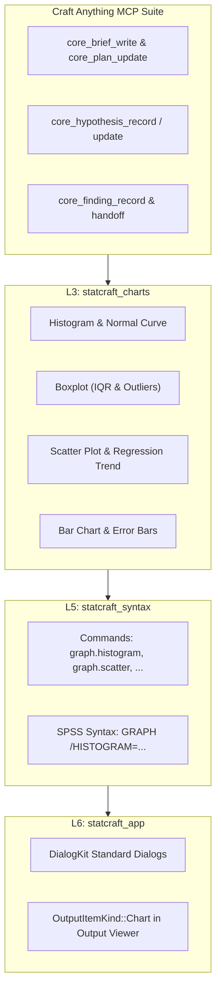

# ТЗ для ИИ-агента: Ветка A — Векторный графический движок L3 statcraft_charts и меню Graphs (Фаза 9)

> **Стандарт экосистемы:** ArtCraft (`storytold`) | Двойная лицензия MIT OR Apache-2.0  
> **Генеральный регламент:** [AGENTS.md](file:///d:/Projects/active/StatCraft/AGENTS.md)  
> **МЕТОДОЛОГИЯ РАЗРАБОТКИ:** Разработка и верификация ведутся **ИСКЛЮЧИТЕЛЬНО с помощью инструментов Craft Anything MCP** (доказательный Clean-Room аудит, фиксация гипотез `core_hypothesis_record`, сбор доказательств `evidence://`, регистрация находок `core_finding_record` и протоколирование в `docs/CRAFT_ANYTHING_AUDIT_REPORT.md`).  
> **Ограничение ресурсов:** ВСЕ команды сборки и тестов запускаются строго с флагом `-j 1`.  
> **Принцип надежности:** 100% Safe Rust, Never Crash (0 `unwrap()`, 0 `expect()`, 0 `panic!()`, 0 `unsafe`).  
> **Архитектура слоев:** Строгое соблюдение L0–L6 (`cargo run -p xtask -j 1 -- layers`).  
> **Контроль размеров:** Лимит листовых модулей $\le 500$ строк (`cargo run -p xtask -j 1 -- file-guard`).  
> **Стандарт диалогов:** Канонический `DialogKit` (`cargo run -p xtask -j 1 -- design-guard`).  
> **Локализация:** 0% сырых строковых литералов в коде UI (строго Fluent-каталоги `en.ftl` и `ru.ftl`).  
> **Интерфейс:** Vector-First UI (0 эмодзи, 0 квадратов «тофу»).

---

## 1. Роль и инструментальный цикл Craft Anything MCP

Разработка графического слоя L3 и диалогов визуализации строится **исключительно на базе исследовательского цикла Craft Anything MCP**:
1. **Постановка задачи и бриф (`core_brief_write`):** фиксация целей исследования канонических параметров диаграмм SPSS (правила Скотта/Стерджеса для гистограмм, усы Тьюки $1.5 \times IQR$ для боксплотов, доверительные интервалы 95% для столбцов).
2. **План шагов (`core_plan_update`):** пошаговый контроль стадий проектирования и реализации с отметками `todo` $\to$ `doing` $\to$ `done`.
3. **Формирование и проверка гипотез (`core_hypothesis_record` / `core_hypothesis_update`):**
   * Проверка правил нарезки карманов гистограмм при малых и больших $N$;
   * Проверка алгоритма выявления экстремальных выбросов ($3 \times IQR$) и умеренных ($1.5 \times IQR$);
   * Проверка наложения кривой Гаусса при нулевой дисперсии ($s = 0$);
   * Привязка доказательств `evidence://` к каждой гипотезе со статусом `supported`.
4. **Фиксация находок (`core_finding_record`):** фиксация верифицированных параметров графиков в базе знаний.
5. **Финализация и передача контекста (`core_handoff_write`):** сохранение состояния сессии и обновление отчета `docs/CRAFT_ANYTHING_AUDIT_REPORT.md`.

---

## 2. Архитектура и модули по слоям

### 2.1. Слой L3: Создание крейта `crates/statcraft_charts`
* **Файл манифеста `crates/statcraft_charts/Cargo.toml`:**
  * Зависимости: `statcraft_core`, `statcraft_algo`, `egui = "0.29"`, `egui_plot = "0.29"`.
* **Модульная структура ($\le 500$ строк на модуль):**
  * `src/lib.rs`: экспорт структур `ChartSpec`, `ChartKind`, `ChartRenderer`.
  * `src/model.rs`: типы данных для отрисовки (`SeriesData`, `PlotPoint`, `BoxplotStats`, `ErrorBarData`).
  * `src/histogram.rs`: расчет бинов, вычисление плотности Гаусса, построение `egui_plot::BarChart` и кривой.
  * `src/boxplot.rs`: расчет перцентилей Тьюки, поиск точек-выбросов, формирование ящиков и усов.
  * `src/scatter.rs`: двумерные точки, фильтрация парных пропусков, расчет МНК $a$ и $b$, линия тренда.
  * `src/bar_chart.rs`: агрегирование категорий, расчет 95% CI, построение вертикальных столбцов и усов погрешностей.
* **Регистрация в архитектуре:**
  * Добавить `statcraft_charts` в `xtask/src/layers.rs` (Уровень L3).

### 2.2. Слой L5: Командная шина `statcraft_syntax`
* **Модули команд в `crates/statcraft_syntax/src/commands/`:**
  * `histogram_cmd.rs` (`graph.histogram`): валидация числовой шкалы, опция `normal_curve: bool`.
  * `scatter_cmd.rs` (`graph.scatter`): валидация пары $(X, Y)$, опция `fit_line: bool`.
  * `boxplot_cmd.rs` (`graph.boxplot`): переменная и опциональный группирующий фактор.
  * `bar_chart_cmd.rs` (`graph.bar`): категориальная и числовая переменные.
* **Синтаксический парсер:**
  * Маппинг синтаксиса `GRAPH /HISTOGRAM(...)`, `GRAPH /SCATTERPLOT(...)` в `SyntaxDispatcher`.

### 2.3. Слой L6: Output Viewer и DialogKit в `statcraft_app`
* **Модель вывода `crates/statcraft_app/src/views/output_view/model.rs`:**
  * Вариант `OutputItemKind::Chart(ChartData)`.
  * Модуль отрисовки `crates/statcraft_app/src/views/output_view/tables_charts.rs`: интерактивный виджет `egui_plot::Plot`.
* **Диалоги `crates/statcraft_app/src/dialogs/`:**
  * `histogram_dialog.rs`, `scatter_dialog.rs`, `boxplot_dialog.rs`, `bar_chart_dialog.rs`.
  * Все диалоги строго через `DialogShell::standard(560, 430)`, `VariablePicker` и `DialogActionBar`.
* **Меню `crates/statcraft_app/src/app_menus/analyze_etc.rs`:**
  * Подключить реальные действия и снять `InDev` для пунктов подменю `Graphs`.

### 2.4. Локализация (`locales/en.ftl` и `locales/ru.ftl`)
* Двуязычные семантические ключи:
  * `menu-graphs-histogram`, `menu-graphs-scatter`, `menu-graphs-boxplot`, `menu-graphs-bar`;
  * `dialog-histogram-title`, `dialog-histogram-normal-curve`;
  * `dialog-scatter-title`, `dialog-scatter-fit-line`;
  * `dialog-boxplot-title`, `dialog-bar-title`, `output-chart-export-svg`.

---

## 3. Критерии приёмки и верификация (Definition of Done)

1. **Протокол Craft Anything MCP:**
   * Полная цепочка `core_brief_write` $\to$ `core_plan_update` $\to$ `core_hypothesis_record` $\to$ `core_finding_record` $\to$ `core_handoff_write`.
   * Синхронизация отчета `docs/CRAFT_ANYTHING_AUDIT_REPORT.md`.
2. **Компиляция и слои:**
   * Сборка строго с `-j 1`.
   * `cargo run -p xtask -j 1 -- layers` подтверждает валидность слоя L3.
3. **Тестирование:**
   * 100% модульных тестов алгоритмов расчета бинов и квантилей ящиков пройдены.
   * Тесты headless-рендеринга без паник при пустых выборках, константных векторах и сплошных `NaN`.
4. **Линтеры и стандарты:**
   * `cargo run -p xtask -j 1 -- file-guard` (все новые файлы $\le 500$ строк).
   * `cargo run -p xtask -j 1 -- design-guard` (0 нарушений стандарта DialogKit).
   * `cargo test -p statcraft_app --test dialog_invariants -j 1` (100% PASS).
   * `cargo clippy --workspace -j 1 -- -D warnings` и `cargo fmt --check` чисты.
5. **Синхронизация документации:**
   * Обновление `docs/CHECKLIST.md`, `docs/parity-checklist.md`, `docs/CHRONICLE.md` и `docs/CHRONICLE.en.md`.
