# ТЗ для ИИ-агента: Ветка B — Нативный кодек записи IBM SPSS .sav (L0 statcraft_io)

> **Стандарт экосистемы:** ArtCraft (`storytold`) | Двойная лицензия MIT OR Apache-2.0  
> **Генеральный регламент:** [AGENTS.md](file:///d:/Projects/active/StatCraft/AGENTS.md)  
> **МЕТОДОЛОГИЯ РАЗРАБОТКИ:** Разработка и верификация ведутся **ИСКЛЮЧИТЕЛЬНО с помощью инструментов Craft Anything MCP** (доказательный Clean-Room аудит бинарных структур, фиксация гипотез `core_hypothesis_record`, проверка байтовых смещений `evidence://`, регистрация находок `core_finding_record` и протоколирование в `docs/CRAFT_ANYTHING_AUDIT_REPORT.md`).  
> **Ограничение ресурсов:** ВСЕ команды сборки и тестов запускаются строго с флагом `-j 1`.  
> **Принцип надежности:** 100% Safe Rust, Never Crash (0 `unwrap()`, 0 `expect()`, 0 `panic!()`, 0 `unsafe`).  
> **Принцип Clean-Room:** 100% чистая реализация без проприетарных DLL; спецификация GNU PSPP & ReadStat.  
> **Архитектура слоев:** Строгое соблюдение L0–L6 (`cargo run -p xtask -j 1 -- layers`).  
> **Контроль размеров:** Лимит листовых модулей $\le 500$ строк (`cargo run -p xtask -j 1 -- file-guard`).  
> **Локализация:** 0% сырых строковых литералов в коде UI (строго Fluent-каталоги `en.ftl` и `ru.ftl`).

---

## 1. Роль и инструментальный цикл Craft Anything MCP

Разработка бинарного сериализатора формата `.sav` осуществляется **строго под доказательным управлением Craft Anything MCP**:
1. **Постановка задачи и бриф (`core_brief_write`):**
   * Формулирование требований к бинарному формату SPSS `.sav` (сигнатура `$FL2`, кодирование записей Record Type 1, 2, 3/4, 7, нарезка 8-байтовых блоков опкодов).
   * Изоляция от проприетарного исходного кода, соблюдение режима Clean-Room.
2. **Управление планом расследования (`core_plan_update`):**
   * Шаг 1: Верификация структуры заголовка Record Type 1 и таймстемпов.
   * Шаг 2: Верификация описателей колонок Record Type 2 и кодов пропусков.
   * Шаг 3: Верификация словарей меток Record Type 3/4.
   * Шаг 4: Верификация Record Type 7 (Subtype 11 для шкал, Subtype 20 для UTF-8, Subtype 14 для длинных строк).
   * Шаг 5: Верификация алгоритма байтовой компрессии опкодов 1..255.
3. **Регистрация и подтверждение гипотез (`core_hypothesis_record` / `core_hypothesis_update`):**
   * Гипотеза о декодировании и кодировании опкода 254 ($0.0$) и 255 (`SYSMIS`);
   * Гипотеза о кратности 4 байтам текстовых меток переменных в Record Type 2;
   * Гипотеза об обязательности Record Type 999 в качестве терминатора секции метаданных;
   * Каждая гипотеза подтверждается прикреплением `evidence_ids` со статусом `supported`.
4. **Фиксация находок (`core_finding_record`):**
   * Документирование точных бинарных смещений и инвариантов упаковки данных в проекте.
5. **Финализация и передача контекста (`core_handoff_write`):**
   * Синхронное обновление двуязычных отчетов `docs/CRAFT_ANYTHING_AUDIT_REPORT.md` и `docs/CORPUS_AUDIT_REPORT.md`.

---

## 2. Архитектура и модули по слоям

```mermaid
flowchart LR
    subgraph CA ["Craft Anything MCP Suite"]
        Brief["core_brief_write"]
        Hypo["Hypothesis verification"]
        Find["Findings & Evidence IDs"]
    end

    subgraph L0 ["L0: statcraft_io (spss_writer/)"]
        Header["Record 1: Header ($FL2)"]
        Vars["Record 2: Variables"]
        Labels["Record 3/4: Value Labels"]
        R7["Record 7: Subtypes 11, 14, 20"]
        Comp["Bytecode Compression (Opcodes 1..255)"]
    end

    subgraph L5 ["L5: statcraft_syntax"]
        Cmd["data.export_sav (SAVE OUTFILE=...)"]
    end

    subgraph L6 ["L6: statcraft_app"]
        Menu["File -> Save Data As (*.sav)"]
    end

    CA --> L0
    L0 --> L5
    L5 --> L6
```

### 2.1. Слой L0: Модули `crates/statcraft_io/src/spss_writer/`
* **Декомпозиция модулей ($\le 500$ строк на модуль):**
  * `mod.rs`: Публичная функция `write_sav<W: Write>(table: &RawTable, dict: &VariableDictionary, writer: &mut W) -> Result<(), IoError>`.
  * `header.rs`: Формирование структуры `RecordType1` (сигнатура `$FL2`, имя продукта `StatCraft Rust`, версия, таймстемп, флаг сжатия `compression = 1`, `case_weight_var = 0`, смещение `bias = 100.0`, `sysmis = -f64::MAX`).
  * `variable_records.rs`: Сериализация `RecordType2` для каждого столбца (тип, метка переменной с дополнением пробелами до кратности 4, форматы вывода `PRINT` и `WRITE`, 3 дискретных или диапазонных пропуска).
  * `value_labels.rs`: Сериализация `RecordType3` (список пар `f64 -> String`) и `RecordType4` (массив индексов переменных).
  * `subtypes.rs`: Сериализация `RecordType7` (Subtype 11 для `Measure`, `Width`, `Align`; Subtype 20 для UTF-8; Subtype 14 для `VeryLongString`).
  * `compression.rs`: Стриминговый упаковщик опкодов `SavDataEncoder` (нарезка блоков по 8 байт, упаковка целых чисел, опкод 254 для $0.0$, опкод 255 для `SYSMIS`, буферизация несжатых значений).

### 2.2. Слой L5: Командная шина `statcraft_syntax`
* **Команда `crates/statcraft_syntax/src/commands/save_sav_cmd.rs`:**
  * Реализация `EngineCommand` для `data.export_sav`.
  * Валидация прав доступа и корректности расширения `.sav`.
  * Генерация канонического синтаксиса `SAVE OUTFILE='...' /COMPRESSED.`.
  * Регистрация в `CommandBus::with_defaults()`.
* **Синтаксический парсер:**
  * Добавить маппинг директивы `SAVE OUTFILE=...` в `mappers/data.rs`.

### 2.3. Слой L6: Пользовательский интерфейс `statcraft_app`
* **Файловый сеанс `crates/statcraft_app/src/app_session.rs`:**
  * Реализовать метод `save_data_as_sav(&mut self)` с диалогом выбора пути через `rfd::FileDialog::new().add_filter("SPSS Data", &["sav"])`.
* **Меню `crates/statcraft_app/src/app_menus/file_edit_view.rs`:**
  * Активировать пункт `menu-file-save-data-as` («Сохранить данные как... -> Файл SPSS (*.sav)»).
* **Статусная строка:**
  * Добавить отображение имени сохраненного файла и индикатора успешной записи.

### 2.4. Локализация (`locales/en.ftl` и `locales/ru.ftl`)
* Добавить ключи:
  * `menu-file-save-data-sav = SPSS Data (*.sav)...` / `Данные SPSS (*.sav)...`
  * `status-file-saved-sav = Data successfully saved to { $path }` / `Данные успешно сохранены в { $path }`
  * `dialog-save-sav-title = Save SPSS Data File` / `Сохранить файл данных SPSS`

---

## 3. Критерии приёмки и верификация (Definition of Done)

1. **Протокол Craft Anything MCP:**
   * Полный цикл `core_brief_write` $\to$ `core_plan_update` $\to$ `core_hypothesis_record` $\to$ `core_finding_record` $\to$ `core_handoff_write`.
   * Доказательная привязка гипотез в `docs/CRAFT_ANYTHING_AUDIT_REPORT.md`.
2. **Компиляция и ресурсы:**
   * Строго с флагом `-j 1`.
3. **Математическая обратимость (Round-Trip Test):**
   * Пакет тестов `spss_roundtrip_tests.rs`:
     - Тест на сохранение числовых матриц с $0.0$, отрицательными числами и `SYSMIS`;
     - Тест на сохранение строковых колонок и длинных строк ($> 255$ байт);
     - Тест на сохранение меток значений `ValueLabels` (русский UTF-8 и латиница);
     - Тест на сохранение шкал измерения `Scale`, `Ordinal`, `Nominal`;
     - Инвариант: $\text{DataSet}_0 \xrightarrow{\text{write\_sav}} \text{bytes} \xrightarrow{\text{read\_sav}} \text{DataSet}_1 \equiv \text{DataSet}_0$.
4. **Стресс-тест в `cargo xtask test-corpus`:**
   * Сериализация и десериализация массива в $100\,000$ строк.
5. **Контроль кодовой базы:**
   * `cargo run -p xtask -j 1 -- file-guard` (модули $\le 500$ строк).
   * `cargo run -p xtask -j 1 -- layers` (L0 не зависит от верхних слоев).
   * `cargo clippy --workspace -j 1 -- -D warnings` — 0 предупреждений.
   * `cargo fmt --check` — чисто.
6. **Документация:**
   * Обновление `docs/CHECKLIST.md`, `docs/parity-checklist.md`, `docs/CHRONICLE.md` и `docs/CHRONICLE.en.md`.
