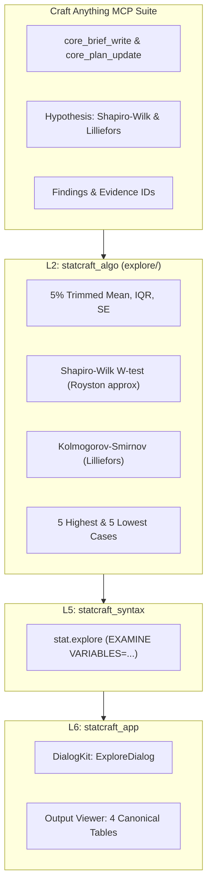

# ТЗ для ИИ-агента: Ветка C — Разведочный анализ данных Explore / EXAMINE и тесты нормальности (Фаза 7.1)

> **Стандарт экосистемы:** ArtCraft (`storytold`) | Двойная лицензия MIT OR Apache-2.0  
> **Генеральный регламент:** [AGENTS.md](file:///d:/Projects/active/StatCraft/AGENTS.md)  
> **МЕТОДОЛОГИЯ РАЗРАБОТКИ:** Разработка и верификация ведутся **ИСКЛЮЧИТЕЛЬНО с помощью инструментов Craft Anything MCP** (доказательный Clean-Room аудит алгоритмов, фиксация гипотез `core_hypothesis_record`, сверка формул `evidence://`, регистрация находок `core_finding_record` и протоколирование в `docs/CRAFT_ANYTHING_AUDIT_REPORT.md`).  
> **Ограничение ресурсов:** ВСЕ команды сборки и тестов запускаются строго с флагом `-j 1`.  
> **Принцип надежности:** 100% Safe Rust, Never Crash (0 `unwrap()`, 0 `expect()`, 0 `panic!()`, 0 `unsafe`).  
> **Архитектура слоев:** Строгое соблюдение L0–L6 (`cargo run -p xtask -j 1 -- layers`).  
> **Контроль размеров:** Лимит листовых модулей $\le 500$ строк (`cargo run -p xtask -j 1 -- file-guard`).  
> **Стандарт диалогов:** Канонический `DialogKit` (`cargo run -p xtask -j 1 -- design-guard`).  
> **Локализация:** 0% сырых строковых литералов в коде UI (строго Fluent-каталоги `en.ftl` и `ru.ftl`).  
> **Интерфейс:** Vector-First UI (0 эмодзи, 0 квадратов «тофу»).

---

## 1. Роль и инструментальный цикл Craft Anything MCP

Реализация разведочного анализа данных `EXAMINE` опирается **исключительно на доказательный аппарат Craft Anything MCP**:
1. **Постановка задачи и бриф (`core_brief_write`):**
   * Анализ канона IBM SPSS 24 Algorithms Guide для процедуры `EXAMINE`: структура таблиц вывода, формулы 5% усеченного среднего, алгоритм аппроксимации Ройстона для критерия Шапиро-Уилка $W$ ($3 \le N \le 5000$) и табличные квантили Даллала-Уилкинсона для критерия Лиллиефорса.
2. **План этапов расследования (`core_plan_update`):**
   * Шаг 1: Формирование дескриптивных метрик и интервалов $IQR$.
   * Шаг 2: Алгоритм критерия нормальности Лиллиефорса с поправкой Колмогорова-Смирнова.
   * Шаг 3: Алгоритм критерия нормальности Шапиро-Уилка $W$.
   * Шаг 4: Алгоритм экстремумов (5 Highest / 5 Lowest).
   * Шаг 5: Моделирование диалога `ExploreDialog` по DialogKit.
3. **Регистрация и подтверждение гипотез (`core_hypothesis_record` / `core_hypothesis_update`):**
   * Гипотеза об отсечении ровно $0.05 \cdot N$ верхних и нижних наблюдений при расчете 5% Trimmed Mean (с дробным взвешиванием граничных элементов);
   * Гипотеза о совпадении $W$-статистики Шапиро-Уилка со `scipy.stats.shapiro` с точностью $\le 10^{-5}$;
   * Гипотеза об обработке связок (ties) при расчете критерия Лиллиефорса;
   * Фиксация `evidence_ids` в протоколе со статусом `supported`.
4. **Фиксация находок (`core_finding_record`):**
   * Регистрация математических формул и доказанной каноничности алгоритмов в базе знаний.
5. **Финализация и передача контекста (`core_handoff_write`):**
   * Добавление раздела EXAMINE в `docs/CRAFT_ANYTHING_AUDIT_REPORT.md` и `docs/SPSS_ALGORITHMS_AUDIT.md`.

---

## 2. Архитектура и модули по слоям

### 2.1. Слой L2: Математический модуль `crates/statcraft_algo/src/explore/`
* **Декомпозиция модуля ($\le 500$ строк на файл):**
  * `mod.rs`: Публичные структуры `ExploreResult`, `ExploreGroupResult`, `ExploreOptions` и функция `compute_explore`.
  * `descriptives.rs`: Расчет 5% усеченного среднего, $IQR$, доверительных интервалов и обработка пропусков (listwise/pairwise).
  * `normality_ks.rs`: Реализация критерия Колмогорова-Смирнова с поправкой Лиллиефорса.
  * `normality_sw.rs`: Реализация критерия Шапиро-Уилка $W$ с полиномиальной аппроксимацией весов Ройстона.
  * `extremes.rs`: Алгоритм извлечения 5 минимальных и 5 максимальных значений с сохранением оригинальных индексов строк.
* **Математический Золотой Оракул (Golden Oracle):**
  * Сверка расчетов в `#[cfg(test)] mod tests` со `scipy.stats.shapiro`, `scipy.stats.kstest` и эталонными выводами SPSS 24 с погрешностью $\le 10^{-6}$.

### 2.2. Слой L5: Командная шина `statcraft_syntax`
* **Команда `crates/statcraft_syntax/src/commands/explore_cmd.rs`:**
  * Реализация трейта `EngineCommand` для `stat.explore`.
  * Валидация входных параметров (хотя бы одна зависимая переменная).
  * Генерация канонического синтаксиса `EXAMINE VARIABLES=...`.
  * Регистрация в `CommandBus::with_defaults()`.
* **Маппинг синтаксиса:**
  * Добавить разбор подкоманды `EXAMINE` в `SyntaxParser` и `SyntaxDispatcher` (`mappers/stats.rs`).

### 2.3. Слой L4/L6: Output Viewer и DialogKit в `statcraft_app`
* **Таблицы вывода `crates/statcraft_app/src/views/output_view/tables_explore.rs`:**
  * Рендеринг 4 аутентичных таблиц SPSS (`render_explore_tables`): Case Processing Summary, Descriptives, Tests of Normality, Extreme Values;
  * Поддержка экспорта сводки в TSV (`explore_to_tsv`).
* **Диалог `crates/statcraft_app/src/dialogs/explore_dialog.rs`:**
  * `DialogShell::standard(560, 430)`;
  * Левая панель: `VariablePicker` доступных переменных;
  * Правая верхняя панель: список зависимых переменных (`Dependent List`) с кнопкой переноса `TransferButton`;
  * Правая нижняя панель: поле фактора (`Factor List`) с кнопкой переноса;
  * Группа настроек `GroupBox`: чекбокс «Критерии нормальности» (*Normality plots with tests*);
  * Нижняя панель действий `DialogActionBar`.
* **Меню `crates/statcraft_app/src/app_menus/analyze_etc.rs`:**
  * Активация пункта `menu-analyze-explore` («Анализ -> Описательные статистики -> Исследовать...»).

### 2.4. Локализация (`locales/en.ftl` и `locales/ru.ftl`)
* Добавить все ключи:
  * `menu-analyze-explore`, `dialog-explore-title`, `dialog-explore-dependent-list`, `dialog-explore-factor-list`, `dialog-explore-normality-tests`;
  * `output-explore-case-processing`, `output-explore-descriptives`, `output-explore-normality`, `output-explore-extremes`, `output-explore-trimmed-mean`.

---

## 3. Критерии приёмки и верификация (Definition of Done)

1. **Протокол Craft Anything MCP:**
   * Полный цикл `core_brief_write` $\to$ `core_plan_update` $\to$ `core_hypothesis_record` $\to$ `core_finding_record` $\to$ `core_handoff_write`.
   * Доказательная база гипотез по критериям нормальности зафиксирована в `docs/CRAFT_ANYTHING_AUDIT_REPORT.md`.
2. **Ресурсы и компиляция:**
   * Строго с флагом `-j 1`.
3. **Точность алгоритмов (Golden Oracle):**
   * Сверка значений $W$ и $p$-value теста Шапиро-Уилка с `scipy.stats.shapiro` с точностью $\le 10^{-5}$.
   * Сверка критерия Лиллиефорса с эталонами SPSS 24.
4. **Надежность (Never Crash):**
   * Модульные тесты с пустыми группами, выборками из 1–2 наблюдений, константными векторами ($SD = 0$) и сплошными пропусками.
5. **Контроль качества кода:**
   * `cargo run -p xtask -j 1 -- file-guard` ($\le 500$ строк на файл).
   * `cargo run -p xtask -j 1 -- design-guard` (0 нарушений стандарта DialogKit).
   * `cargo test -p statcraft_app --test dialog_invariants -j 1` (100% PASS).
   * `cargo run -p xtask -j 1 -- ci` (все 9 ступеней шлюза качества пройдены).
6. **Документация:**
   * Обновление `docs/CHECKLIST.md`, `docs/parity-checklist.md`, `docs/CHRONICLE.md` и `docs/CHRONICLE.en.md`.
